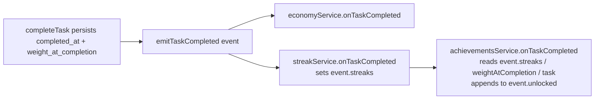

# Design Document

## Overview

The Achievements feature unlocks milestone rewards when a user completes a task. It is a **completion-event listener** (registered on the existing dispatcher) plus a single authenticated read endpoint. On each completion the listener inspects the `CompletionEvent` — the completed task, its already-computed completion weight, and the just-updated streak values published by the streak listener — and idempotently unlocks any newly-earned milestone. Each newly-unlocked achievement is appended to `event.unlocked` so the task-completion HTTP response can celebrate it.

The feature reuses infrastructure that already exists and is tested on disk. **No new migration is required.**

- `achievements` table + `idx_achievements_unique` — migration `1000000000001`.
- `CompletionEvent`, dispatcher, and `event.unlocked` / `event.streaks` channels — `src/services/completion/completionEvents.ts`.
- Streak listener that populates `event.streaks` — `src/services/streaks/streakService.ts`, registered before achievements.
- `weight_at_completion` / `repeat_series_id` task columns — migration `1000000000003`.
- User-local calendar-date helpers — `src/services/time/userTime.ts`.

Task recurrence and analytics are out of scope.

### Confirmed Design Decisions

The working assumptions flagged in the requirements are now final:

- **DD-1 — `productivity_burst_10` recurs once per user-local day.** The `Unique_Slot` is the user's Local_Calendar_Date (`'YYYY-MM-DD'`). A new burst can be earned on each distinct local day. (Requirement 4)
- **DD-2 — `high_weight_completed` unlocks once per qualifying task** (repeatable across tasks). The `Unique_Slot` is the task `id`. "High weight" means `event.weightAtCompletion >= threshold` — this is the **already-computed** completion weight carried on the event (and persisted to `tasks.weight_at_completion`); the service does **NOT** recompute weight. (Requirement 6)
- **DD-3 — streak milestones fire on `>= N`** combined with idempotent `ON CONFLICT DO NOTHING`. Because the unique index prevents a second row, an already-unlocked milestone never re-fires, and the `>= N` check is robust to skipped streak values (e.g. a streak that jumps past 7). (Requirements 2, 3)

## Architecture

### Layering

The feature follows the project's layered convention: **route → controller → service → repository → `pg`**.

```
GET /api/achievements
  achievementsRoutes  (authMiddleware, scopes to req.userId)
    → achievementsController.get
      → achievementsService.getAchievements(userId)
        → achievementsRepository.listForUser(userId)

emitTaskCompleted(event)   (completion dispatcher)
  → achievementsService.onTaskCompleted(event)   [listener]
      → achievementsRepository.unlock(...)                  (idempotent insert)
      → achievementsRepository.countCompletionsOnLocalDay() (day-count query)
      → userRepository.findById(userId)                     (resolve timezone)
```

### Completion-listener slot (after streaks)

The achievements listener is registered in `registerAllListeners` **after** the streak listener. This ordering is load-bearing: the streak listener writes `event.streaks = { daily, series? }` during its own `onTaskCompleted`, and achievements reads those values without re-querying. Economy order relative to the pair does not matter (independent).



The listener reads exactly three inputs from the event and one from the DB:

| Source | Used for |
| --- | --- |
| `event.task` (`TaskWithMeta`) | `repeat_series_id`, `deferral_count`, `id`, `user_id` |
| `event.weightAtCompletion` (number) | high-weight milestone (already computed — never recomputed) |
| `event.streaks` (`{ daily, series? }` \| undefined) | daily-streak and per-series-streak milestones |
| DB query (`countCompletionsOnLocalDay`) | productivity-burst milestone |

### The day-count query (timezone boundary)

`productivity_burst_10` needs the count of the user's tasks completed **within the user's local day** — this value is not on the event. `completed_at` is a `timestamptz` (an instant); the user-local day is a `'YYYY-MM-DD'` in the user's IANA zone. To bucket instants into the user's calendar day we push the conversion into Postgres:

```sql
SELECT COUNT(*)::int AS count
FROM tasks
WHERE user_id = $1
  AND completed_at IS NOT NULL
  AND (completed_at AT TIME ZONE $2)::date = $3::date
```

- `$2` = the resolved IANA timezone string (e.g. `'America/New_York'`).
- `$3` = the user's Local_Calendar_Date (`'YYYY-MM-DD'`), from `localCalendarDate(resolveTimezone(user.settings.timezone))` — the same helper streaks uses to derive "today".

**Why `AT TIME ZONE`:** applied to a `timestamptz`, `AT TIME ZONE <zone>` yields the wall-clock `timestamp` in that zone; `::date` then extracts the local calendar day. Comparing that to `$3::date` selects exactly the completions that fall on the user's local day, in the database, with no app-side instant-range arithmetic. This mirrors the timezone-boundary discipline already established by streaks (resolve the zone once, do the calendar math against that zone).

**Just-completed task is included:** `completeTask` sets `completed_at` (and `weight_at_completion`) and persists the task **before** emitting the event, so the task that triggered this completion is already counted by the query. No off-by-one adjustment is needed.

### Timezone resolution

The service resolves the user's local day exactly as streaks does:

```
const user = await userRepo.findById(event.userId);
const tz = resolveTimezone(user?.settings.timezone);   // UTC fallback when unset/invalid/missing
const localDay = localCalendarDate(tz);                 // 'YYYY-MM-DD'
```

`localDay` is used both as the productivity-burst `Unique_Slot` and as `$3` (with `tz` as `$2`) in the day-count query.

## Components and Interfaces

### achievementsRepository (`src/repositories/achievementsRepository.ts`)

Data access for the `achievements` table. All queries parameterized.

```ts
/**
 * Idempotently unlock one achievement. `slot` is written to data.task_id (the
 * column idx_achievements_unique reads); null slot => COALESCE→'' => one row
 * per (user, type). `dataExtra` may carry a readable alias (series_id / local_date).
 * Returns true iff a NEW row was created (i.e. this is a newly-unlocked achievement).
 */
export async function unlock(
  userId: string,
  type: string,
  slot: string | null,
  dataExtra?: Record<string, unknown>,
): Promise<boolean>;

/** Count the user's tasks completed on the given user-local day (tz-aware). */
export async function countCompletionsOnLocalDay(
  userId: string,
  tz: string,
  localDay: string,
): Promise<number>;

/** All achievements for a user, newest first, scoped to user_id. */
export async function listForUser(userId: string): Promise<AchievementRow[]>;
```

`unlock` implements Requirement 7 with a single statement:

```sql
INSERT INTO achievements (user_id, type, data)
VALUES ($1, $2, $3::jsonb)
ON CONFLICT (user_id, type, (COALESCE(data->>'task_id', '')))
DO NOTHING
RETURNING id
```

- The conflict target repeats the **exact index expression** (a plain column list cannot address an expression index — same pattern as `streakRepository.upsert`).
- `$3` is the JSON `data` payload built by the service (see Data Models). When `slot` is non-null it contains `task_id: slot`; when null it omits `task_id` so `COALESCE(...,'')` collapses to the single global slot.
- `rowCount === 1` (a returned `id`) ⇒ newly created ⇒ `unlock` returns `true`. A conflict returns zero rows ⇒ `false`.

`listForUser`:

```sql
SELECT id, type, unlocked_at, data
FROM achievements
WHERE user_id = $1
ORDER BY unlocked_at DESC
```

### achievementsService (`src/services/achievements/achievementsService.ts`)

```ts
/** Completion listener — registered AFTER the streak listener. */
export async function onTaskCompleted(event: CompletionEvent): Promise<void>;

/** Read model for GET /api/achievements. */
export async function getAchievements(userId: string): Promise<AchievementRow[]>;
```

`onTaskCompleted` orchestrates the checks in order and appends each newly-created unlock to `event.unlocked`:

1. **first_task_completed** — DB-dependent (needs "has the user any prior first?"). Handled purely by the idempotent insert: attempt `unlock(userId, 'first_task_completed', null)`; append only if it returns `true`. (Req 1)
2. **daily streak milestones** — only when `event.streaks?.daily` is defined. For each `N` in `[7, 14, 30, 90]` where `daily >= N`, attempt `unlock(userId, 'daily_streak_${N}', null)`; append on `true`. (Req 2)
3. **repeatable-series milestones** — only when `event.task.repeat_series_id` is non-null AND `event.streaks?.series` is defined. For each `N` in `[7, 30, 100]` where `series >= N`, attempt `unlock(userId, 'repeatable_streak_${N}', repeat_series_id, { series_id })`; append on `true`. (Req 3)
4. **accountable_procrastination** — when `event.task.deferral_count >= 3`, attempt `unlock(userId, 'accountable_procrastination', task.id)`; append on `true`. (Req 5)
5. **high_weight_completed** — when `event.weightAtCompletion >= config.achievements.highWeightThreshold`, attempt `unlock(userId, 'high_weight_completed', task.id)`; append on `true`. (Req 6)
6. **productivity_burst_10** — resolve `tz` + `localDay`; `count = countCompletionsOnLocalDay(...)`; when `count >= 10`, attempt `unlock(userId, 'productivity_burst_10', localDay, { local_date: localDay })`; append on `true`. (Req 4)

Each helper appends `{ type, data }` to `event.unlocked` **only** when `unlock` returned `true` (Requirement 7.2/7.3, 8). The `data` on the appended `Unlocked_Achievement` mirrors the persisted `data` so the client sees the slot value (Req 8.3).

To keep the whole listener non-throwing in normal operation (Req 10.3) and never break completion even on an unexpected error (Req 10.2, guaranteed by the dispatcher regardless), the service does not throw for expected states (missing user, `event.streaks` undefined, empty counts).

### Pure decision helper (unit/property-testable)

Extract a pure function for the **event-derivable** candidates, so the type/slot decisions can be tested without a database:

```ts
export interface Candidate { type: string; slot: string | null; dataExtra?: Record<string, unknown>; }

/** Candidates decidable from the event alone (no DB). */
export function candidateUnlocks(event: CompletionEvent, threshold: number): Candidate[];
```

`candidateUnlocks` covers the milestones whose *condition* is fully determined by the event:

- daily-streak (from `event.streaks.daily`),
- repeatable-series (from `event.streaks.series` + `repeat_series_id`),
- accountable_procrastination (from `deferral_count`),
- high_weight_completed (from `weightAtCompletion` vs `threshold`).

It deliberately **excludes** the two DB-dependent milestones, which cannot be decided from the event alone:

- **first_task_completed** — "no prior first" is a DB fact; decided by the idempotent insert result.
- **productivity_burst_10** — needs the day-count DB query.

`onTaskCompleted` runs `candidateUnlocks` for the pure set, then handles `first_task_completed` and `productivity_burst_10` separately with their DB inputs. This split is documented so tests know which decisions are pure vs DB-dependent.

### achievementsController (`src/controllers/achievementsController.ts`)

Mirrors `economyController`:

```ts
export async function get(req, res, next): Promise<void> {
  try {
    const data = await achievementsService.getAchievements(req.userId as string);
    res.status(200).json({ success: true, data });
  } catch (err) { next(err); }
}
```

### achievementsRoutes (`src/routes/achievementsRoutes.ts`)

Mirrors `economyRoutes`; mounted at `/api/achievements` in `app.ts`.

```ts
const router = Router();
router.use(authMiddleware);   // 401 when unauthenticated (Req 9.2)
router.get('/', achievementsController.get);
export default router;
```

`app.ts` adds `app.use('/api/achievements', achievementsRoutes);`.

### Listener registration

`registerAllListeners` adds the achievements listener **after** the streak listener (the file already carries a comment marking this spot):

```ts
registerCompletionListener(economyService.onTaskCompleted);
registerCompletionListener(streakService.onTaskCompleted);
registerCompletionListener(achievementsService.onTaskCompleted); // AFTER streaks
```

(Requirement 10.1)

## Data Models

### Achievements_Table (existing — no migration)

| Column | Type | Notes |
| --- | --- | --- |
| `id` | uuid pk | `gen_random_uuid()` |
| `user_id` | uuid | FK `users` ON DELETE CASCADE |
| `type` | varchar(100) | Achievement_Type |
| `unlocked_at` | timestamptz | default `NOW()` |
| `data` | jsonb | default `'{}'` |

Unique index: `idx_achievements_unique ON (user_id, type, (COALESCE(data->>'task_id', '')))`.

### The `data.task_id` slot — the crux of idempotency

The unique index keys on `data->>'task_id'`, **not** on a physical column. Therefore **every per-slot achievement must store its slot value under the `data.task_id` key**, even when the value is semantically a series id or a date. Otherwise two different series/days/tasks would collide on the empty-string slot and only the first would ever unlock.

Decision (documented and adopted): **store the slot value under `data.task_id` for the index, and additionally store a readable semantic alias** so the payload is self-describing to clients and future maintainers.

| Achievement_Type | Trigger condition | Slot → `data.task_id` | Full `data` payload |
| --- | --- | --- | --- |
| `first_task_completed` | first ever completion (per user) | *(none — global)* | `{}` |
| `daily_streak_7` | `event.streaks.daily >= 7` | *(none — global)* | `{}` |
| `daily_streak_14` | `event.streaks.daily >= 14` | *(none — global)* | `{}` |
| `daily_streak_30` | `event.streaks.daily >= 30` | *(none — global)* | `{}` |
| `daily_streak_90` | `event.streaks.daily >= 90` | *(none — global)* | `{}` |
| `repeatable_streak_7` | `repeat_series_id != null && event.streaks.series >= 7` | `repeat_series_id` | `{ task_id: <series_id>, series_id: <series_id> }` |
| `repeatable_streak_30` | `... series >= 30` | `repeat_series_id` | `{ task_id: <series_id>, series_id: <series_id> }` |
| `repeatable_streak_100` | `... series >= 100` | `repeat_series_id` | `{ task_id: <series_id>, series_id: <series_id> }` |
| `productivity_burst_10` | `countCompletionsOnLocalDay >= 10` | `localDay` (`'YYYY-MM-DD'`) | `{ task_id: <localDay>, local_date: <localDay> }` |
| `accountable_procrastination` | `deferral_count >= 3` | `task.id` | `{ task_id: <task.id> }` |
| `high_weight_completed` | `weightAtCompletion >= threshold` | `task.id` | `{ task_id: <task.id> }` |

**Global-once** types (`first_task_completed`, `daily_streak_*`) store no `task_id`, so `COALESCE(...,'')` collapses them to one row per `(user_id, type)`. **Per-slot** types store their distinct slot value under `task_id`, so they unlock once per distinct slot and independently across slots (Req 3.4, 4.3, 5.2, 6.3).

### Config addition (`src/config/index.ts`)

Add an `achievements` block mirroring the `economy` style:

```ts
// AppConfig interface
achievements: {
  highWeightThreshold: number;
};

// config object
achievements: {
  highWeightThreshold: parseInt(process.env.ACHIEVEMENTS_HIGH_WEIGHT_THRESHOLD ?? '200', 10),
},
```

Default `200` (Requirement 6.1). Read via `config.achievements.highWeightThreshold`.

### Types

```ts
export interface AchievementRow {
  id: string;
  type: string;
  unlocked_at: Date;
  data: Record<string, unknown>;
}
```

`CompletionEvent`, `UnlockedAchievement`, and `TaskWithMeta` are reused unchanged.

## Correctness Properties

*A property is a characteristic or behavior that should hold true across all valid executions of a system — essentially, a formal statement about what the system should do. Properties serve as the bridge between human-readable specifications and machine-verifiable correctness guarantees.*

The event-derivable decisions are extracted into the pure `candidateUnlocks(event, threshold)` function (see Components and Interfaces), which is directly property-testable without a database. The database-backed idempotency properties are validated against the `unlock` repository using a real Postgres (the same integration DB the rest of the suite uses).

### Property 1: Unlock idempotency

*For any* user, achievement type, and slot value (including a null slot), calling `unlock` two or more times with the same `(user_id, type, slot)` creates exactly one row and returns `true` on the first call and `false` on every subsequent call.

**Validates: Requirements 1.1, 1.2, 7.1, 7.4**

### Property 2: Append iff newly created

*For any* completion event, the achievements listener appends an `Unlocked_Achievement` to `event.unlocked` for a given `(type, slot)` exactly when the corresponding `unlock` created a new row (returned `true`), and never appends when `unlock` reported a conflict — so re-evaluating the same completion adds each achievement to `event.unlocked` at most once per newly-created row.

**Validates: Requirements 1.3, 2.6, 3.6, 4.5, 5.3, 6.4, 7.2, 7.3, 8.1, 8.2**

### Property 3: Per-slot independence

*For any* user and achievement type, and any two distinct slot values `s1 != s2`, unlocking `(user, type, s1)` and `(user, type, s2)` each create a separate row (both return `true`), so per-slot achievement types unlock independently for each distinct series id, task id, or user-local day.

**Validates: Requirements 3.4, 4.3, 5.2, 6.3**

### Property 4: Threshold candidate correctness and monotonicity

*For any* completion event and configured threshold, `candidateUnlocks` yields a numeric-threshold milestone candidate (`daily_streak_N` from `event.streaks.daily`; `repeatable_streak_N` from `event.streaks.series` when `repeat_series_id` is non-null; `accountable_procrastination` from `deferral_count >= 3`; `high_weight_completed` from `weightAtCompletion >= threshold`) **if and only if** the corresponding value is greater than or equal to that milestone's threshold; and increasing any such value never removes a candidate that already qualified (monotonicity). When `event.streaks` or the relevant field is undefined, or `repeat_series_id` is null, no candidate for the corresponding streak family is produced.

**Validates: Requirements 2.1, 2.2, 2.3, 2.4, 2.5, 3.1, 3.2, 3.3, 3.5, 5.1, 6.2, 10.4**

### Property 5: Per-slot payload correctness

*For any* per-slot candidate produced by `candidateUnlocks` (repeatable-series, accountable-procrastination, high-weight — and, at the service layer, productivity-burst), the constructed `data` payload stores the candidate's slot value under `data.task_id` (the key `idx_achievements_unique` reads), so the appended `Unlocked_Achievement` carries the slot value.

**Validates: Requirements 3.1, 3.2, 3.3, 5.1, 6.2, 8.3**

## Error Handling

- **Missing user / missing timezone:** `userRepo.findById` may return null (or `settings.timezone` may be unset/invalid). `resolveTimezone` coalesces to UTC; the day-count and burst evaluation proceed against UTC rather than throwing. (Mirrors the streak listener's `user?.settings.timezone` handling.)
- **`event.streaks` undefined:** the listener evaluates only the non-streak milestones (first-completion, productivity-burst, accountable-procrastination, high-weight) and skips the streak-based ones. This happens naturally because the streak candidates are gated on `event.streaks?.daily` / `event.streaks?.series` being defined. (Requirement 10.4)
- **Listener never throws in normal operation** (Requirement 10.3): expected states (missing user, absent streaks, zero counts, conflicting inserts) are handled without throwing.
- **Dispatcher isolation as backstop** (Requirement 10.2): even if the listener throws unexpectedly, `emitTaskCompleted` catches and logs the error and never rethrows, so task completion always succeeds. This is existing, tested behavior in `completionEvents.ts` — the achievements listener relies on it as a safety net but does not depend on it for normal flow.
- **Read endpoint errors** are forwarded to the centralized `errorHandler` via `next(err)`, matching `economyController`.
- **SQL safety:** all queries are parameterized (`$1, $2, ...`); no string interpolation. The `unlock` conflict target repeats the exact index expression.

## Testing Strategy

The suite follows the project's dual approach — property tests for universal logic, unit tests for pure/config decisions, and Jest + Supertest integration tests for the HTTP and DB-backed behavior.

### Property-based tests (fast-check, devDependency)

Each property test runs a **minimum of 100 iterations** and is tagged with a comment referencing its design property:

`// Feature: achievements, Property {number}: {property_text}`

- **Property 1 (Unlock idempotency)** — generate random `(userId, type, slot|null)`; call `unlock` twice; assert first returns `true`, second returns `false`, and exactly one row exists. (DB-backed against the integration Postgres.)
- **Property 2 (Append iff newly created)** — drive the append logic with a stubbed `unlock` returning a generated boolean sequence; assert `event.unlocked` gains an entry exactly on `true` results and nothing on `false`.
- **Property 3 (Per-slot independence)** — generate two distinct slots for the same `(user, type)`; assert both unlocks return `true` and two rows exist.
- **Property 4 (Threshold candidate correctness & monotonicity)** — generate random `event.streaks.daily/series` (including undefined), `repeat_series_id` (including null), `deferral_count`, `weightAtCompletion`, and `threshold`; assert `candidateUnlocks` contains exactly the milestones whose value `>= N`, and that raising a value never drops an already-qualifying candidate.
- **Property 5 (Per-slot payload correctness)** — generate per-slot candidates; assert each carries its slot under `data.task_id`.

Each correctness property is implemented by a **single** property-based test. We use `fast-check`; we do not hand-roll a generator framework.

### Unit / smoke tests

- **Config default (Req 6.1):** with `ACHIEVEMENTS_HIGH_WEIGHT_THRESHOLD` unset, `config.achievements.highWeightThreshold === 200`.
- **Registration order (Req 10.1):** assert the achievements listener is registered after the streak listener (so `event.streaks` is populated first).

### Integration tests (Jest + Supertest)

Test isolation follows the established **listener-reset determinism** pattern: `clearCompletionListeners()`, then register streak listener **then** achievements listener, so `event.streaks` is available.

- **First completion + response (Req 1, 8):** complete a task; assert the completion response `unlocked` contains `first_task_completed`; `GET /api/achievements` lists it.
- **Idempotency across repeated completions (Req 7):** complete tasks such that a second completion would re-evaluate `first_task_completed`; assert it is not appended again and no duplicate row is created.
- **Productivity burst (Req 4):** complete 10 tasks within one user-local day; assert `productivity_burst_10` unlocks once (with `data.task_id`/`data.local_date` = the local day); an 11th same-day completion does not re-unlock. Include a **cross-midnight, non-UTC timezone** case to validate the `AT TIME ZONE` bucketing (Req 4.1, 4.4) and a second local day to confirm per-day independence (Req 4.3).
- **Per-series streak milestone (Req 3):** drive a completion where `event.streaks.series >= 7` for a task with a `repeat_series_id`; assert `repeatable_streak_7` unlocks keyed to the series id; a different series unlocks independently (Req 3.4).
- **High weight (Req 6):** complete a task whose persisted `weight_at_completion` (carried as `event.weightAtCompletion`) is `>= threshold`; assert `high_weight_completed` keyed to the task id; assert the value is **not recomputed** (the event weight is used verbatim).
- **Accountable procrastination (Req 5):** defer a task 3 times, then complete it; assert `accountable_procrastination` keyed to the task id.
- **Read endpoint (Req 9):** `GET /api/achievements` returns `200 { success, data }` scoped to the user; a second user's achievements are excluded; unauthenticated request returns `401`; a user with none returns `200` with an empty list.
- **`event.streaks` undefined (Req 10.4):** register achievements **without** the streak listener; complete a qualifying task; assert non-streak milestones (first, high-weight, accountable, burst) still unlock and no streak milestone is attempted.
- **Dispatcher isolation (Req 10.2):** force the listener to throw; assert task completion still succeeds and the error is logged.

### Requirement-to-section map

| Requirement | Design coverage |
| --- | --- |
| 1 First completion | Service step 1; Property 1, 2; integration |
| 2 Daily streak | Service step 2; Property 4, 2; integration |
| 3 Series streak | Service step 3; Property 4, 3, 5; integration |
| 4 Productivity burst | Day-count query; service step 6; Property 3, 5; integration |
| 5 Accountable procrastination | Service step 4; Property 4, 3, 5; integration |
| 6 High weight | Config; service step 5; Property 4, 3, 5; unit + integration |
| 7 Idempotent unlocking | `unlock` design; Property 1, 2 |
| 8 Response reflects unlocks | Service append rule; Property 2, 5; integration |
| 9 Read endpoint | Controller + route; integration |
| 10 Registration & reliability | Registration; Error Handling; Property 4 (10.4); integration/smoke |
