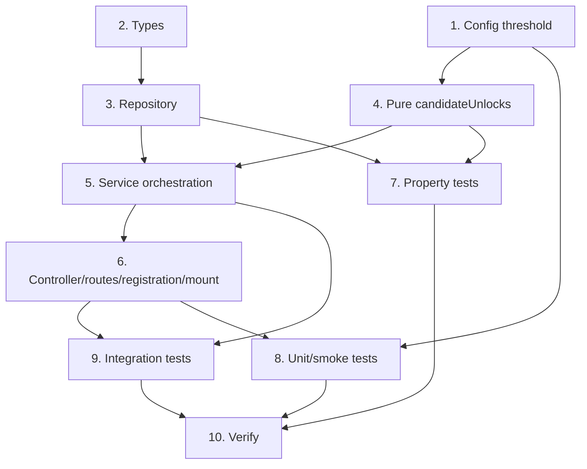

# Implementation Plan: Achievements

## Overview

Completion listener that idempotently unlocks milestone achievements and appends them to `event.unlocked` (celebrated in the complete response), plus one authenticated read endpoint. Reuses the existing `achievements` table + `idx_achievements_unique` — **no new migration**. Reads the just-updated `event.streaks`, so the listener MUST register AFTER the streak listener. Tasks marked `*` are optional.

## Tasks

- [x] 1. Config: high-weight threshold
  - Add `achievements: { highWeightThreshold: number }` to `AppConfig` and the `config` object in `src/config/index.ts`, `parseInt(process.env.ACHIEVEMENTS_HIGH_WEIGHT_THRESHOLD ?? '200', 10)` (mirrors the `economy` block)
  - _Requirements: 6.1_

- [x] 2. Types
  - Add `AchievementRow { id: string; type: string; unlocked_at: Date; data: Record<string, unknown> }` (colocate with the achievements service/repo). Reuse `CompletionEvent`, `UnlockedAchievement`, `TaskWithMeta` unchanged
  - _Requirements: 9.1, 9.4_

- [x] 3. achievementsRepository (`src/repositories/achievementsRepository.ts`)
  - `unlock(userId, type, slot: string | null, dataExtra?)` builds `data` from the slot (under `task_id`) plus `dataExtra`, runs `INSERT ... ON CONFLICT (user_id, type, (COALESCE(data->>'task_id', ''))) DO NOTHING RETURNING id`, returns `true` iff a new row was created (`rowCount === 1`). Conflict target repeats the exact index expression (same pattern as `streakRepository.upsert`)
  - `countCompletionsOnLocalDay(userId, tz, localDay)` uses `WHERE user_id=$1 AND completed_at IS NOT NULL AND (completed_at AT TIME ZONE $2)::date = $3::date`, `COUNT(*)::int`
  - `listForUser(userId)` selects `id, type, unlocked_at, data WHERE user_id=$1 ORDER BY unlocked_at DESC` (user-scoped)
  - All parameterized; no string interpolation
  - _Requirements: 4.1, 4.4, 7.1, 7.2, 7.3, 9.1, 9.3_

- [x] 4. Pure candidate helper (`candidateUnlocks`)
  - In `src/services/achievements/achievementsService.ts`: `interface Candidate { type; slot: string | null; dataExtra? }` and `candidateUnlocks(event, threshold): Candidate[]` — the event-derivable milestones only
  - daily-streak `[7,14,30,90]` gated on `event.streaks?.daily >= N`; repeatable-series `[7,30,100]` gated on `repeat_series_id != null && event.streaks?.series >= N` (slot = series id, alias `series_id`); `accountable_procrastination` when `deferral_count >= 3` (slot = task id); `high_weight_completed` when `weightAtCompletion >= threshold` (slot = task id)
  - Excludes the two DB-dependent milestones (`first_task_completed`, `productivity_burst_10`)
  - _Requirements: 2.1, 2.2, 2.3, 2.4, 2.5, 3.1, 3.2, 3.3, 3.4, 3.5, 5.1, 6.2, 10.4_

- [x] 5. achievementsService orchestration
  - `onTaskCompleted(event)` listener: run `candidateUnlocks(event, config.achievements.highWeightThreshold)`; for each candidate call `repo.unlock(...)` and append `{ type, data }` to `event.unlocked` only when it returns `true`
  - `first_task_completed`: `unlock(userId, "first_task_completed", null)`; append on `true` (idempotency = no prior first)
  - `productivity_burst_10`: resolve `tz` via `userRepo.findById` + `resolveTimezone`, `localDay = localCalendarDate(tz)`; `count = countCompletionsOnLocalDay(userId, tz, localDay)`; when `count >= 10` call `unlock(userId, "productivity_burst_10", localDay, { local_date: localDay })`; append on `true`
  - Appended `data` mirrors the persisted `data` (slot under `task_id` + readable alias) so the client sees the slot value; non-throwing for expected states (missing user, undefined `event.streaks`, zero counts, conflicts)
  - `getAchievements(userId)` returns `repo.listForUser(userId)`
  - _Requirements: 1.1, 1.2, 1.3, 2.6, 3.6, 4.2, 4.5, 5.2, 5.3, 6.3, 6.4, 7.4, 8.1, 8.2, 8.3, 10.3, 10.4_

- [x] 6. Controller, routes, registration, mount
  - `achievementsController.get` (mirrors economyController): `{ success: true, data }`, `next(err)` on error
  - `achievementsRoutes`: `router.use(authMiddleware); router.get("/", get)` (401 unauthenticated)
  - Register `achievementsService.onTaskCompleted` in `registerAllListeners` AFTER the streak listener
  - Mount `app.use("/api/achievements", achievementsRoutes)` in `app.ts`
  - _Requirements: 9.1, 9.2, 9.5, 10.1_

- [x] 7. Property-based tests (fast-check, min 100 runs each, tagged `// Feature: achievements, Property N: ...`)
  - P1 Unlock idempotency (DB-backed): random `(userId, type, slot|null)`; `unlock` twice yields `true` then `false`, exactly one row
  - P2 Append iff newly created: stub `unlock` with a generated boolean sequence; `event.unlocked` gains an entry exactly on `true`
  - P3 Per-slot independence (DB-backed): two distinct slots for same `(user, type)` yield both `true`, two rows
  - P4 Threshold candidate correctness & monotonicity: random `streaks.daily/series` (incl. undefined), `repeat_series_id` (incl. null), `deferral_count`, `weightAtCompletion`, `threshold`; `candidateUnlocks` contains exactly the milestones with value `>= N`; raising a value never drops a qualifying candidate
  - P5 Per-slot payload correctness: each per-slot candidate carries its slot under `data.task_id`
  - _Requirements: 1.1, 1.2, 7.1, 7.2, 7.3, 7.4, 2.1, 2.2, 2.3, 2.4, 3.1, 3.2, 3.3, 3.4, 4.3, 5.1, 5.2, 6.2, 6.3, 8.3_

- [x] 8. Unit / smoke tests
  - Config default: with `ACHIEVEMENTS_HIGH_WEIGHT_THRESHOLD` unset, `config.achievements.highWeightThreshold === 200`
  - Registration order: achievements listener registered after the streak listener
  - _Requirements: 6.1, 10.1_

- [x] 9. Integration tests (Jest + Supertest; listener-reset determinism — register streak THEN achievements)
  - First completion + response: complete a task; response `unlocked` has `first_task_completed`; `GET /api/achievements` lists it (Req 1, 8)
  - Idempotency: re-evaluated `first_task_completed` not appended again, no duplicate row (Req 7)
  - Productivity burst: 10 completions in one user-local day yields `productivity_burst_10` once (data.task_id/local_date = local day); 11th no re-unlock; include a cross-midnight non-UTC timezone case (AT TIME ZONE bucketing) and a second local day for per-day independence (Req 4)
  - Per-series streak: `event.streaks.series >= 7` with `repeat_series_id` yields `repeatable_streak_7` keyed to series id; different series unlocks independently (Req 3)
  - High weight: persisted `weight_at_completion >= threshold` yields `high_weight_completed` keyed to task id, weight used verbatim (not recomputed) (Req 6)
  - Accountable procrastination: defer 3x, complete, yields `accountable_procrastination` keyed to task id (Req 5)
  - Read endpoint: `GET /api/achievements` yields `200 { success, data }` user-scoped; another user is excluded; unauthenticated yields `401`; empty yields `200` empty list (Req 9)
  - `event.streaks` undefined: register achievements WITHOUT the streak listener; non-streak milestones still unlock, no streak milestone attempted (Req 10.4)
  - Dispatcher isolation: force listener to throw; completion still succeeds, error logged (Req 10.2)
  - _Requirements: 1.1, 1.3, 3.1, 3.4, 4.2, 4.3, 4.4, 5.1, 6.2, 7.1, 8.1, 9.1, 9.2, 9.3, 9.5, 10.2, 10.4_

- [x] 10. Verify — `npm run typecheck` + full `npm test` green (no regressions to the existing 118)
  - _Requirements: 10.3_

## Task Dependency Graph



```json
{
  "waves": [
    { "id": 0, "tasks": ["1", "2"] },
    { "id": 1, "tasks": ["3", "4"] },
    { "id": 2, "tasks": ["5", "7"] },
    { "id": 3, "tasks": ["6"] },
    { "id": 4, "tasks": ["8", "9"] },
    { "id": 5, "tasks": ["10"] }
  ]
}
```

## Notes

- **No new migration.** The existing `achievements` table and `idx_achievements_unique ON (user_id, type, (COALESCE(data->>'task_id','')))` are reused as-is.
- **Slot crux:** every per-slot achievement stores its slot value under the `data.task_id` key (the key the unique index reads) even when it is semantically a series id or a local date, plus a readable alias (`series_id` / `local_date`). Global-once types store no `task_id`.
- **Confirmed decisions:** DD-1 `productivity_burst_10` once per user-local day (slot = local date); DD-2 `high_weight_completed` once per qualifying task using the already-computed `event.weightAtCompletion` (never recompute); DD-3 streak milestones fire on `>= N` with idempotent `ON CONFLICT DO NOTHING`.
- **Registration ordering is load-bearing:** the achievements listener must be registered AFTER the streak listener so `event.streaks` is populated before it runs.
- **Timezone discipline:** the productivity-burst day is the user local calendar date via `localCalendarDate(resolveTimezone(user.settings.timezone))`; the day-count query buckets `completed_at` with `AT TIME ZONE`. The just-completed task is already persisted before the event is emitted, so it is counted with no off-by-one.
