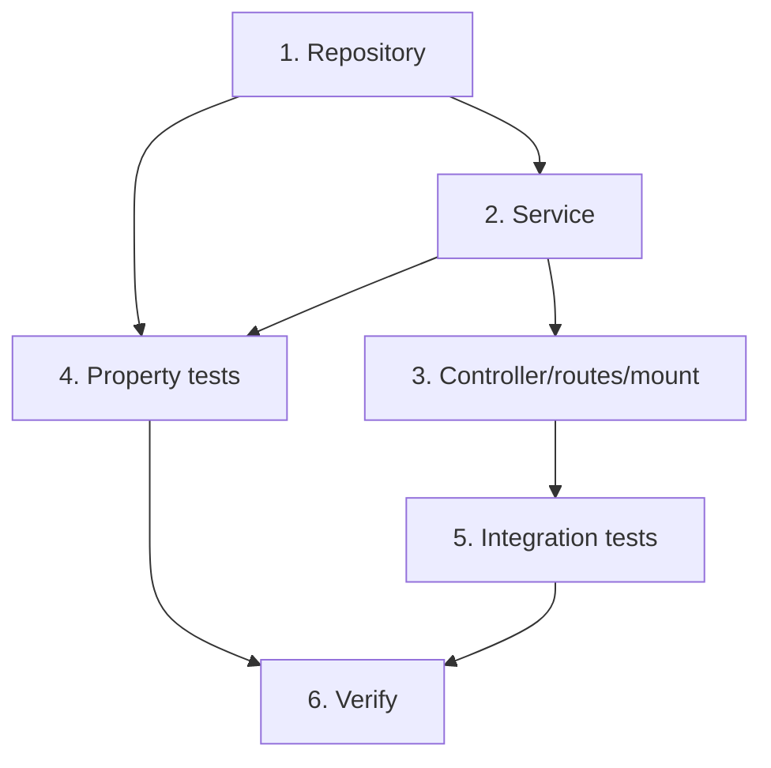

# Implementation Plan: Analytics

## Overview

Read-only per-project completion analytics behind one authenticated endpoint `GET /api/analytics/projects`. One aggregate query (LEFT JOIN projects -> task_projects -> tasks, completed-non-archived filter in the ON clause), service maps `MAX(completed_at)` to the user-local calendar date. No migration, no listener. Every completed task is already in some project (Real or Unassigned) after the projects-management revision, so no unassigned special-casing. Tasks marked `*` optional.

## Tasks

- [ ] 1. analyticsRepository (`src/repositories/analyticsRepository.ts`)
  - `ProjectCompletionStatsRow { id, name, priority_order, color, tasks_completed:int, weight_completed:int, last_completed_at: Date|null }`
  - `projectCompletionStats(userId)`: `SELECT p.id,p.name,p.priority_order,p.color, COUNT(t.id)::int AS tasks_completed, COALESCE(SUM(t.weight_at_completion),0)::int AS weight_completed, MAX(t.completed_at) AS last_completed_at FROM projects p LEFT JOIN task_projects tp ON tp.project_id=p.id LEFT JOIN tasks t ON t.id=tp.task_id AND t.user_id=$1 AND t.completed_at IS NOT NULL AND t.archived_at IS NULL WHERE p.user_id=$1 GROUP BY p.id ORDER BY p.priority_order ASC`
  - Completed/non-archived filter in the LEFT JOIN ON clause (empty projects still yield a zero row); parameterized; user-scoped
  - _Requirements: 1.2, 1.3, 1.4, 1.5, 3.1, 4.1, 6.2, 6.3_

- [ ] 2. analyticsService (`src/services/analytics/analyticsService.ts`)
  - `ProjectAnalytics { projectId, name, priorityOrder, color, tasksCompleted, weightCompleted, lastCompletionDate: string|null }`
  - `getProjectAnalytics(userId)`: resolve `tz = resolveTimezone((await userRepo.findById(userId))?.settings.timezone)`; `rows = analyticsRepository.projectCompletionStats(userId)`; map each row -> DTO with `lastCompletionDate = row.last_completed_at ? localCalendarDate(tz, row.last_completed_at) : null`; rename id->projectId, priority_order->priorityOrder; pass ints through; preserve order
  - No writes
  - _Requirements: 2.1, 2.2, 2.3, 2.4, 6.1_

- [ ] 3. Controller + routes + mount
  - `analyticsController.getProjects` (mirror economyController): `{ success:true, data }`, `next(err)`
  - `analyticsRoutes`: `router.use(authMiddleware); router.get("/projects", getProjects)`
  - Mount `app.use("/api/analytics", analyticsRoutes)` in app.ts
  - _Requirements: 5.1, 5.3_

- [ ] 4. Property-based tests (fast-check, min 100 runs, tagged `// Feature: analytics, Property N: ...`, DB-backed)
  - `src/repositories/analyticsRepository.property.test.ts` (fresh user per run for isolation; valid YYYY-MM-DD via integer y/m/d, NOT fc.date().toISOString())
  - P1 Count & weight: seed N completed tasks with random weights in a project -> tasksCompleted==N, weightCompleted==sum (null weight as 0)
  - P2 Only completed/non-archived/owned contribute: seed a mix of active/archived/completed/other-user -> only owner completed non-archived count
  - P3 Multi-project: a completed task linked to K projects counts in each
  - P4 Every project once, empties zeroed: N projects some empty -> exactly N rows, priority_order-ordered, empties zeroed
  - P5 Last completion date: seed completions at random instants -> lastCompletionDate == localCalendarDate(tz, max instant), null when none (exercise via analyticsService)
  - _Requirements: 1.2, 1.3, 1.4, 1.5, 2.1, 2.2, 2.3, 2.4, 3.1, 4.1, 5.2_

- [ ] 5. Integration tests (Jest + Supertest)
  - Shape + basic aggregation: 2 projects, complete tasks -> 200 `{success,data}` per-project counts/weight + fields (Req 1, 3.3)
  - Empty project included with zeros + null date (Req 3.1)
  - Unassigned rollup: a no-Real_Project completed task appears under the Unassigned project row (Req 3.2)
  - Multi-project completion counts in both (Req 1.4)
  - Active + archived tasks excluded (Req 1.5)
  - Last completion date + non-UTC timezone crossing local midnight (Req 2, DD-4)
  - Ordering by priority_order asc (Unassigned first at 0) (Req 4.1)
  - Auth 401; user-scoped (other user excluded); no-projects -> 200 empty list (Req 5)
  - _Requirements: 1.1, 1.4, 1.5, 2.1, 3.1, 3.2, 3.3, 4.1, 5.1, 5.2, 5.4_

- [ ] 6. Verify — typecheck + full `npm test` green (existing 169 stay green + new)
  - _Requirements: all_

## Task Dependency Graph



```json
{
  "waves": [
    { "id": 0, "tasks": ["1"] },
    { "id": 1, "tasks": ["2"] },
    { "id": 2, "tasks": ["3", "4"] },
    { "id": 3, "tasks": ["5"] },
    { "id": 4, "tasks": ["6"] }
  ]
}
```


## Notes

- **No migration, no listener.** Pure read over existing tables.
- **Single aggregate query**; completed/non-archived filter lives in the LEFT JOIN ON clause so empty projects still return a zero row (DD-1); GROUP BY over task_projects means a multi-project task counts per project (DD-2).
- **lastCompletionDate** is the user-local calendar day: SQL returns `MAX(completed_at)` (true instant), the service converts via `localCalendarDate(tz, instant)` (DD-4). Null when no completions.
- **Null weight_at_completion** counts as 0 via COALESCE(SUM,0); the task is still counted (DD-5).
- **No unassigned special-case** (DD-3 resolved): every completed task is in a project (Real or Unassigned) after the projects-management revision, so the Unassigned project row is the previously project-less rollup.
- **Property-test gotcha:** generate dates via integer y/m/d (day 1-28), NOT `fc.date().toISOString()` (can throw RangeError on boundary values under some seeds).
