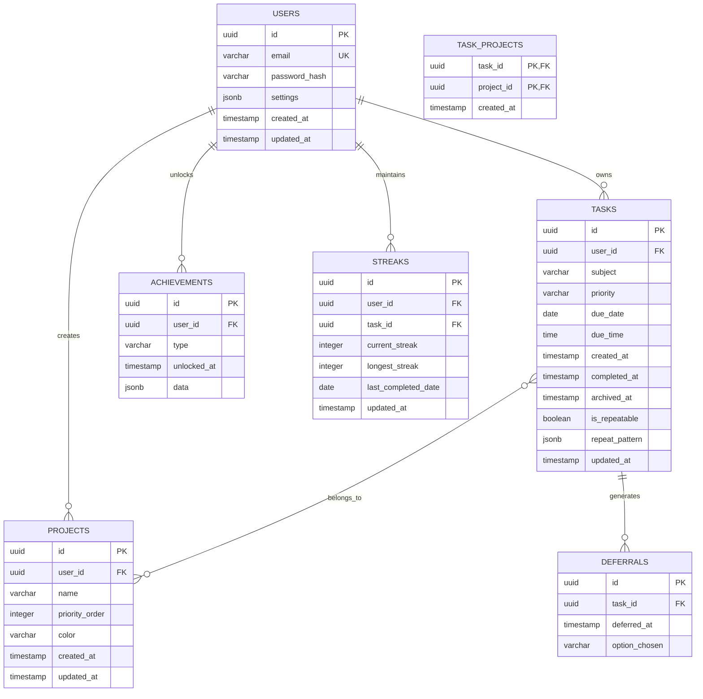

# Database Schema Design Document

## Overview

The TaskMaster database schema implements a PostgreSQL-based data layer supporting user authentication, task management, project organization, and gamification features. The design follows relational database best practices with UUID primary keys, foreign key constraints, strategic indexing, and JSONB storage for flexible data. The schema supports the weight-based task prioritization algorithm and provides efficient queries for real-time task sorting and analytics.

## Architecture

### Database Technology Stack

- **Database Engine**: PostgreSQL 14+
- **Migration Tool**: node-pg-migrate (lightweight, SQL-based migrations)
- **Connection Library**: node-postgres (pg) for Node.js connectivity
- **Primary Key Strategy**: UUID v4 for all tables
- **Soft Deletion Pattern**: archived_at timestamps instead of hard deletes
- **Flexible Storage**: JSONB columns for settings and configuration data

### Schema Design Principles

1. **Data Integrity**: Foreign key constraints with appropriate CASCADE rules
2. **Performance**: Strategic indexing on frequently queried columns
3. **Scalability**: UUID primary keys support distributed architecture
4. **Flexibility**: JSONB storage for evolving data structures
5. **Audit Trail**: Creation and update timestamps on all tables
6. **User Isolation**: All user data properly scoped with user_id foreign keys

## Database Schema Design

### Entity Relationship Overview



## Table Specifications

### 1. Users Table

**Purpose**: Store user accounts and authentication data

```sql
CREATE TABLE users (
    id UUID PRIMARY KEY DEFAULT gen_random_uuid(),
    email VARCHAR(255) NOT NULL UNIQUE,
    password_hash VARCHAR(255) NOT NULL,
    settings JSONB DEFAULT '{}',
    created_at TIMESTAMP WITH TIME ZONE NOT NULL DEFAULT NOW(),
    updated_at TIMESTAMP WITH TIME ZONE NOT NULL DEFAULT NOW()
);

-- Indexes
CREATE UNIQUE INDEX idx_users_email ON users(email);
CREATE INDEX idx_users_created_at ON users(created_at);
```

**Settings JSONB Structure**:
```json
{
  "project_priority_enabled": true,
  "achievement_toasts_enabled": true,
  "focus_mode_enabled": false,
  "weight_visibility_enabled": false,
  "theme": "light"
}
```

### 2. Tasks Table

**Purpose**: Store all user tasks with support for weight calculation

```sql
CREATE TABLE tasks (
    id UUID PRIMARY KEY DEFAULT gen_random_uuid(),
    user_id UUID NOT NULL REFERENCES users(id) ON DELETE CASCADE,
    subject VARCHAR(500) NOT NULL,
    priority VARCHAR(10) NOT NULL CHECK (priority IN ('high', 'medium', 'low')),
    due_date DATE,
    due_time TIME,
    created_at TIMESTAMP WITH TIME ZONE NOT NULL DEFAULT NOW(),
    completed_at TIMESTAMP WITH TIME ZONE,
    archived_at TIMESTAMP WITH TIME ZONE,
    is_repeatable BOOLEAN NOT NULL DEFAULT FALSE,
    repeat_pattern JSONB,
    updated_at TIMESTAMP WITH TIME ZONE NOT NULL DEFAULT NOW()
);

-- Indexes for performance
CREATE INDEX idx_tasks_user_id ON tasks(user_id);
CREATE INDEX idx_tasks_created_at ON tasks(created_at);
CREATE INDEX idx_tasks_due_date ON tasks(due_date) WHERE due_date IS NOT NULL;
CREATE INDEX idx_tasks_completed_at ON tasks(completed_at) WHERE completed_at IS NOT NULL;
CREATE INDEX idx_tasks_active ON tasks(user_id, completed_at, archived_at) 
    WHERE completed_at IS NULL AND archived_at IS NULL;
CREATE INDEX idx_tasks_priority ON tasks(user_id, priority);
```

**Repeat Pattern JSONB Structure**:
```json
{
  "frequency": "daily",
  "interval": 1,
  "days_of_week": [1, 3, 5],
  "end_date": null
}
```

### 3. Projects Table

**Purpose**: Store user-created projects for task organization

```sql
CREATE TABLE projects (
    id UUID PRIMARY KEY DEFAULT gen_random_uuid(),
    user_id UUID NOT NULL REFERENCES users(id) ON DELETE CASCADE,
    name VARCHAR(255) NOT NULL,
    priority_order INTEGER NOT NULL CHECK (priority_order > 0 AND priority_order <= 20),
    color VARCHAR(7),
    created_at TIMESTAMP WITH TIME ZONE NOT NULL DEFAULT NOW(),
    updated_at TIMESTAMP WITH TIME ZONE NOT NULL DEFAULT NOW(),
    
    -- Ensure unique project names per user
    UNIQUE(user_id, name),
    -- Ensure unique priority order per user
    UNIQUE(user_id, priority_order)
);

-- Indexes
CREATE INDEX idx_projects_user_id ON projects(user_id);
CREATE INDEX idx_projects_priority ON projects(user_id, priority_order);
```

### 4. Task Projects Junction Table

**Purpose**: Many-to-many relationship between tasks and projects

```sql
CREATE TABLE task_projects (
    task_id UUID NOT NULL REFERENCES tasks(id) ON DELETE CASCADE,
    project_id UUID NOT NULL REFERENCES projects(id) ON DELETE CASCADE,
    created_at TIMESTAMP WITH TIME ZONE NOT NULL DEFAULT NOW(),
    
    PRIMARY KEY (task_id, project_id)
);

-- Indexes
CREATE INDEX idx_task_projects_task_id ON task_projects(task_id);
CREATE INDEX idx_task_projects_project_id ON task_projects(project_id);
```

### 5. Deferrals Table

**Purpose**: Track deferral actions for weight calculation and analytics

```sql
CREATE TABLE deferrals (
    id UUID PRIMARY KEY DEFAULT gen_random_uuid(),
    task_id UUID NOT NULL REFERENCES tasks(id) ON DELETE CASCADE,
    deferred_at TIMESTAMP WITH TIME ZONE NOT NULL DEFAULT NOW(),
    option_chosen VARCHAR(20) NOT NULL CHECK (option_chosen IN ('later_today', 'tomorrow', 'sometime_later'))
);

-- Indexes
CREATE INDEX idx_deferrals_task_id ON deferrals(task_id);
CREATE INDEX idx_deferrals_deferred_at ON deferrals(deferred_at);
```

### 6. Achievements Table

**Purpose**: Store unlocked user achievements

```sql
CREATE TABLE achievements (
    id UUID PRIMARY KEY DEFAULT gen_random_uuid(),
    user_id UUID NOT NULL REFERENCES users(id) ON DELETE CASCADE,
    type VARCHAR(100) NOT NULL,
    unlocked_at TIMESTAMP WITH TIME ZONE NOT NULL DEFAULT NOW(),
    data JSONB DEFAULT '{}'
);

-- Prevent duplicate achievements (with task-specific achievements)
CREATE UNIQUE INDEX idx_achievements_unique ON achievements(user_id, type, (data->>'task_id'));

-- Indexes
CREATE INDEX idx_achievements_user_id ON achievements(user_id);
CREATE INDEX idx_achievements_type ON achievements(type);
CREATE INDEX idx_achievements_unlocked_at ON achievements(unlocked_at);
```

**Achievement Data JSONB Examples**:
```json
// Daily streak achievement
{
  "streak_days": 7
}

// Task-specific achievement
{
  "task_id": "uuid",
  "streak_days": 30
}

// Weight-based achievement
{
  "weight_completed": 500
}
```

### 7. Streaks Table

**Purpose**: Track daily and per-task streaks

```sql
CREATE TABLE streaks (
    id UUID PRIMARY KEY DEFAULT gen_random_uuid(),
    user_id UUID NOT NULL REFERENCES users(id) ON DELETE CASCADE,
    task_id UUID REFERENCES tasks(id) ON DELETE CASCADE,
    current_streak INTEGER NOT NULL DEFAULT 0,
    longest_streak INTEGER NOT NULL DEFAULT 0,
    last_completed_date DATE,
    updated_at TIMESTAMP WITH TIME ZONE NOT NULL DEFAULT NOW(),
    
    -- Ensure one streak record per user (daily) or per user-task combination
    UNIQUE(user_id, task_id)
);

-- Indexes
CREATE INDEX idx_streaks_user_id ON streaks(user_id);
CREATE INDEX idx_streaks_task_id ON streaks(task_id) WHERE task_id IS NOT NULL;
CREATE INDEX idx_streaks_last_completed ON streaks(last_completed_date);
```

**Note**: `task_id` is NULL for daily streaks, non-NULL for per-task streaks

## Migration Strategy

### Migration File Structure

```
migrations/
├── 001_create_users_table.sql
├── 002_create_tasks_table.sql
├── 003_create_projects_table.sql
├── 004_create_task_projects_table.sql
├── 005_create_deferrals_table.sql
├── 006_create_achievements_table.sql
├── 007_create_streaks_table.sql
└── 008_create_indexes.sql
```

### Migration Tool Configuration

Using `node-pg-migrate` for lightweight, SQL-based migrations:

```javascript
// migrations/config.js
module.exports = {
  databaseUrl: process.env.DATABASE_URL,
  migrationsTable: 'pgmigrations',
  dir: 'migrations',
  direction: 'up',
  count: Infinity,
  ignorePattern: '.*\\..*',
  schema: 'public',
  decamelize: false,
  createSchema: false,
  createMigrationsSchema: false,
  noLock: false
};
```

### Migration Commands

```bash
# Run all pending migrations
npm run migrate

# Rollback last migration
npm run migrate:rollback

# Create new migration
npm run migrate:create <migration_name>

# Check migration status
npm run migrate:status
```

## Performance Optimization

### Index Strategy

1. **Primary Indexes**: All foreign keys automatically indexed
2. **User Isolation**: Composite indexes on (user_id, other_columns) for user-scoped queries
3. **Temporal Queries**: Indexes on timestamp columns for date-based filtering
4. **Unique Constraints**: Unique indexes for business rules (email, project names)
5. **Partial Indexes**: Conditional indexes for active records only

### Query Optimization Patterns

```sql
-- Efficient active tasks query with weight calculation support
SELECT t.*, COUNT(d.id) as deferral_count
FROM tasks t
LEFT JOIN deferrals d ON t.id = d.task_id
WHERE t.user_id = $1 
  AND t.completed_at IS NULL 
  AND t.archived_at IS NULL
GROUP BY t.id
ORDER BY t.created_at DESC;

-- Efficient project priority query
SELECT p.*, COUNT(tp.task_id) as task_count
FROM projects p
LEFT JOIN task_projects tp ON p.id = tp.project_id
LEFT JOIN tasks t ON tp.task_id = t.id 
  AND t.completed_at IS NULL 
  AND t.archived_at IS NULL
WHERE p.user_id = $1
GROUP BY p.id
ORDER BY p.priority_order ASC;
```

## Data Integrity Rules

### Foreign Key Constraints

- **CASCADE DELETE**: User deletion removes all user-owned data
- **CASCADE DELETE**: Task deletion removes task-project associations and deferrals
- **CASCADE DELETE**: Project deletion removes task-project associations

### Check Constraints

- **Priority Values**: Enum validation for task priority levels
- **Deferral Options**: Enum validation for deferral option choices
- **Project Limits**: Maximum 20 projects per user
- **Positive Values**: Streak counters and priority orders must be positive

### Business Logic Constraints

- **Unique Email**: One account per email address
- **Unique Project Names**: Per user, project names must be unique
- **Unique Priority Order**: Per user, project priority orders must be unique
- **Achievement Uniqueness**: Prevent duplicate achievement unlocks

## Backup and Recovery Strategy

### Automated Backups

```sql
-- Daily backup script
pg_dump $DATABASE_URL > backups/taskmaster_$(date +%Y%m%d).sql

-- Point-in-time recovery setup
ALTER SYSTEM SET wal_level = replica;
ALTER SYSTEM SET archive_mode = on;
ALTER SYSTEM SET archive_command = 'cp %p /backup/archive/%f';
```

### Migration Rollback Safety

- All migrations include both UP and DOWN operations
- Test rollbacks in staging environment before production
- Backup database before running migrations in production
- Use transactions for atomic migration execution