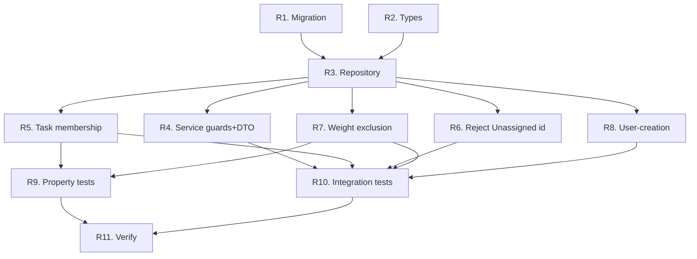

# Implementation Plan: Projects Management

Builds on auth + task-management + existing `projects`/`task_projects` tables. Delivers the full `projectRepository` that supersedes the temporary `projectReadRepository`. All core tasks complete and verified (63 tests passing across the backend). Tasks marked `*` are optional.

- [x] 1. Types
  - `src/types/project.ts`: ProjectRow, ProjectWithCount, ProjectDTO, CreateProjectInput, UpdateProjectInput

- [x] 2. Migration for reorder safety
  - `1000000000002_projects_priority_deferrable`: replace the plain unique INDEX on (user_id, priority_order) with a DEFERRABLE INITIALLY DEFERRED unique CONSTRAINT so multi-row reorders don't hit transient collisions (uniqueness checked at COMMIT). Applied to dev; test DB re-migrates via globalSetup.

- [x] 3. projectRepository (`src/repositories/projectRepository.ts`)
  - Reads: listForUserWithCounts (active counts), listForUser (id+priority_order), countForUser, findByIdForUser, findByNameForUser (case-insensitive), assertOwned
  - create (transactional next order = MAX+1), update (name/color), reorder (single-pass under deferred constraint), remove (delete + close gap; associations cascade, tasks preserved)

- [x] 4. projectService (`src/services/projects/projectService.ts`)
  - create (20-max + case-insensitive uniqueness), list, update (uniqueness excluding self), reorder (validate id set == user's full set), delete

- [x] 5. Controller + routes + validation
  - projectController; express-validator (name 1–255, color #RRGGBB, reorder projectIds UUID array)
  - projectRoutes at `/api/projects`; `PUT /reorder` before `/:id`; wired into app.ts

- [x] 6. Refactor: unify repositories
  - taskService points at projectRepository (listForUser, assertOwned); deleted projectReadRepository.ts; full suite still green

- [x] 7. Tests
  - Unit (mocked repo): 20-max, duplicate name (create+update), reorder set-mismatch
  - Integration: create/list-with-counts (active only), 20-max, duplicate 409, reorder + contiguity + wrong-set 400, delete closes gap + keeps task (task survives, unassigned), ownership isolation, reorder changes task weight ordering

- [x] 8. Verify
  - typecheck + full `npm test` green (63 tests, 8 suites)

- [ ]* 9. Optional
  - [ ]* 9.1 Live smoke against dev DB (covered by integration tests; can do during frontend wiring)

## Revision Tasks: Unassigned Project

Adds the per-user Unassigned project (Requirements 8-12). Migration `1000000000005` + repo/service/task/weight/user-creation changes. Must keep the existing 157 tests green. Tasks marked `*` optional.

- [ ] R1. Migration `1000000000005_default_project`
  - Add `projects.is_default boolean NOT NULL DEFAULT false`
  - Drop + re-add the priority_order CHECK as `>= 0 AND <= 20` (allow order 0 for Unassigned)
  - Partial unique index `uq_projects_one_default ON projects (user_id) WHERE is_default`
  - Backfill: insert one Unassigned (name `Unassigned`, order 0, is_default true) per existing user; link every task with no `task_projects` row to its owner Unassigned
  - Reversible down (unlink default associations, delete default projects, drop index, restore CHECK to 1-20, drop column); apply to dev
  - _Requirements: 8.2, 8.3_

- [ ] R2. Types
  - `ProjectRow` gains `is_default: boolean`; `ProjectDTO` gains `isDefault: boolean` (`ProjectWithCount` inherits)
  - _Requirements: 12.2_

- [ ] R3. projectRepository changes
  - `ensureDefault(userId)` idempotent insert (`ON CONFLICT (user_id) WHERE is_default DO NOTHING` then SELECT existing); `getDefault(userId)`
  - `listForUserWithCounts` + `listForUser` also return `is_default` (order 0 sorts Unassigned first)
  - `countForUser` adds `AND is_default = false` (20-max counts Real_Projects only)
  - `findByIdForUser` returns `is_default`; `reorder` operates only on provided Real_Project ids (Unassigned untouched at order 0)
  - _Requirements: 8.1, 8.4, 10.4, 11.1, 12.1, 12.3_

- [ ] R4. projectService guards + DTO
  - `createProject`: reject reserved name `Unassigned` (case-insensitive) 409; 20-max via Real_Project-only count
  - `updateProject`: reject if target `is_default` (400); reject rename to `Unassigned` (409)
  - `deleteProject`: reject if target `is_default` (400)
  - `reorderProjects`: required set = user Real_Projects only; reject if payload includes the Unassigned id or mismatches (400)
  - `listProjects`: map `is_default` -> `isDefault` in DTO
  - _Requirements: 10.1, 10.2, 10.3, 11.1, 12.2, 12.4_

- [ ] R5. Task-membership auto-management (taskRepository create/update)
  - `linkDefault(client, userId, taskId)` helper (resolve Unassigned id, insert `task_projects` ON CONFLICT DO NOTHING)
  - create: empty/absent projectIds -> link Unassigned; else link Real_Projects only
  - update: new set empty -> link Unassigned; non-empty -> link Real_Projects and remove any Unassigned membership (never both)
  - _Requirements: 9.1, 9.2, 9.3, 9.4, 9.6_

- [ ] R6. Reject client-supplied Unassigned id (taskService)
  - Tighten `projectRepo.assertOwned` (or add a check) so a `projectIds` array containing an `is_default` project id is rejected with 400 on task create/update
  - _Requirements: 9.5_

- [ ] R7. Weight exclusion (taskService.loadUserWeightContext)
  - Exclude `is_default` projects from `orderById` and `totalProjects` so a task in only Unassigned yields `projectPriorityOrder = null` (multiplier skipped) and Real_Project distribution is unchanged; no `weight.ts` change
  - _Requirements: 11.2, 11.3, 11.4_

- [ ] R8. User-creation integration
  - `authService.register` and the Google new-user path call `projectRepo.ensureDefault(user.id)` after user creation (idempotent)
  - _Requirements: 8.1_

- [ ]* R9. Property tests (fast-check, min 100 runs, tagged `// Feature: projects-management, Property N: ...`)
  - P1 Membership exclusive+total: for a random Real_Project assignment, task is in >=1 Real_Project (no Unassigned) or exactly Unassigned (no Real_Project) — never both, never empty
  - P2 Unassigned weight-neutral: a task in only Unassigned weighs the same as an identical no-project task; adding Unassigned never changes a Real_Project task weight
  - _Requirements: 9.1, 9.2, 9.3, 9.4, 9.6, 11.2, 11.3, 11.4_

- [ ] R10. Integration tests
  - Migration/backfill: each existing user has one Unassigned; orphan tasks linked to it
  - User creation (password + Google) makes exactly one Unassigned; ensureDefault twice -> one row
  - Exclusive membership: no-project create -> Unassigned only; Real_Project create -> not Unassigned; update to empty -> Unassigned; update to Real_Project -> Unassigned removed
  - Client cannot assign Unassigned id -> 400
  - Protection: delete/rename/recolor Unassigned -> 400; reorder incl. Unassigned id -> 400; reorder of Real_Projects leaves Unassigned at 0
  - Limits/weight: 20-max counts Real only; Unassigned-only task weight == no-project weight; Unassigned presence does not change a Real_Project task weight
  - List/DTO: GET /api/projects includes Unassigned first, `isDefault:true`; reserved-name create/rename -> 409; taskCount correct
  - _Requirements: 8, 9, 10, 11, 12_

- [ ] R11. Verify — typecheck + full `npm test` green (existing 157 stay green + new)
  - _Requirements: all_

## Task Dependency Graph



```json
{
  "waves": [
    { "id": 0, "tasks": ["R1", "R2"] },
    { "id": 1, "tasks": ["R3"] },
    { "id": 2, "tasks": ["R4", "R5", "R6", "R7", "R8"] },
    { "id": 3, "tasks": ["R9", "R10"] },
    { "id": 4, "tasks": ["R11"] }
  ]
}
```

