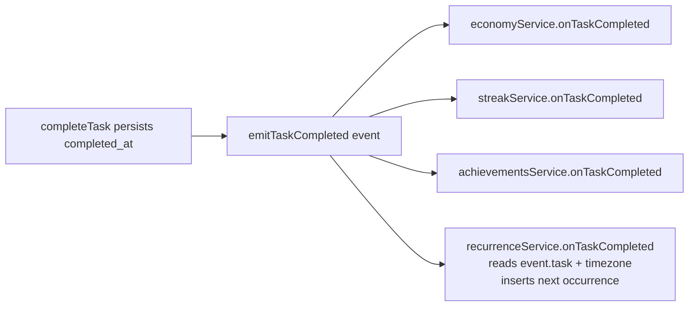

# Design Document

## Overview

Task recurrence regenerates repeatable tasks. It is a **completion-event listener** (registered on the existing dispatcher) with no HTTP surface. On each completion the listener inspects the completed `Task_With_Meta`; if it is repeatable with a non-null `repeat_pattern` and its schedule has not ended, it inserts exactly one active Next_Occurrence sharing the same `repeat_series_id`, with a newly-computed `due_date` and the same subject/priority/projects/due_time/pattern.

The feature reuses infrastructure that already exists and is tested on disk. **No new migration is required.**

- `tasks` table incl. `is_repeatable`, `repeat_pattern`, `repeat_series_id` — migrations `1000000000001`, `1000000000003`.
- `CompletionEvent`, dispatcher, `registerAllListeners` — `src/services/completion/`.
- `RepeatPattern` type and `TaskWithMeta` (with `projects[]`) — `src/types/task.ts`.
- User-local calendar helpers `resolveTimezone` / `localCalendarDate` / `nextCalendarDate` — `src/services/time/userTime.ts`.
- `taskRepository` and its `task_projects` association helper — `src/repositories/taskRepository.ts`.

Analytics and the frontend are out of scope.

### Confirmed Design Decisions

The working assumptions flagged in the requirements are now final:

- **DD-1 — schedule-anchored with completion-day fallback.** The Anchor_Date is the completed occurrence's `due_date` when non-null; otherwise the user's local completion day (`localCalendarDate`). This keeps a fixed cadence for scheduled tasks while still advancing undated repeatables from "today". (Requirements 3.2, 3.3)
- **DD-2 — weekly without `days_of_week` advances by `7 * interval` days** from the Anchor_Date (interval defaults to 1). A weekly pattern with a non-empty `days_of_week` instead lands on the next listed weekday strictly after the anchor. (Requirement 4)
- **DD-3 — `due_time` carries over unchanged** to the Next_Occurrence. (Requirement 2.4)

## Architecture

The feature follows the project's layered convention, minus the HTTP tier (it has no route): **completion listener → service → repository → `pg`**, plus a pure recurrence-math module.

```
emitTaskCompleted(event)   (completion dispatcher)
  → recurrenceService.onTaskCompleted(event)   [listener]
      → (pure) nextDueDate(pattern, anchorDate)          decides the next YYYY-MM-DD (or null past end_date)
      → userRepo.findById(userId)                        resolve timezone for the anchor fallback
      → taskRepository.createOccurrence(...)             insert active copy + project associations (one tx)
```

### Listener slot (order-independent)

Unlike achievements (which must run after streaks), recurrence reads only `event.task` and the user's timezone. It has no dependency on `event.streaks` or `event.unlocked`, so its registration order in `registerAllListeners` does not matter (Requirement 7.4). It is registered after the existing listeners for tidiness.



### Why a listener (not part of completeTask)

Recurrence is a completion side-effect, exactly like economy/streaks/achievements. Implementing it as a listener keeps `completeTask` unchanged and inherits the dispatcher's error isolation: if occurrence generation fails, the completion still succeeds (Requirement 7.2). The new occurrence is a separate row inserted after the original is persisted as completed, so it never interferes with the completion transaction.

## Components and Interfaces

### Pure recurrence math (`src/services/tasks/recurrence.ts`)

A pure, deterministic, I/O-free module — the property-testable core. All dates are 'YYYY-MM-DD' calendar strings; advancement uses the DST-safe UTC-noon math already proven in `nextCalendarDate` (Requirement 3.4, 4.4).

```ts
import type { RepeatPattern } from '../../types/task';

/**
 * The next due date for a repeatable series, or null when the schedule has
 * ended (computed date strictly after end_date). `anchor` is 'YYYY-MM-DD'.
 */
export function nextDueDate(pattern: RepeatPattern, anchor: string): string | null;
```

Behavior:

- **daily:** `next = addDays(anchor, max(1, interval ?? 1))`.
- **weekly + non-empty `days_of_week`:** starting one day after `anchor`, scan forward up to 7 days and return the first date whose weekday (0-6, Sunday=0) is in `days_of_week` (Requirement 4.1, 4.3). Invalid weekday numbers are ignored; if none of the (valid) days match within 7 days — only possible when the array has no valid entry — fall through to the interval rule.
- **weekly + empty/unset `days_of_week`:** `next = addDays(anchor, 7 * max(1, interval ?? 1))` (Requirement 4.2, DD-2).
- **end_date guard:** if `pattern.end_date` is non-null and `next > end_date` (string compare of 'YYYY-MM-DD'), return null (Requirement 5.1, 5.4). Otherwise return `next`.

Helpers (also pure, in the same module or reused from `userTime`):

- `addDays(date, n)` — repeated/`n`-step DST-safe UTC-noon advance (generalizes `nextCalendarDate`, which is the `n = 1` case). Implemented as `Date.UTC(y, m-1, d, 12) + n * 86400000` then read back UTC y/m/d — never applies a timezone offset.
- `weekdayOf(date)` — `new Date(Date.UTC(y, m-1, d, 12)).getUTCDay()` (0-6). UTC-noon keeps it offset-independent.

The module does **not** read a clock, the DB, or the timezone — the caller supplies the resolved `anchor`. This keeps every scheduling rule directly property-testable.

### recurrenceService (`src/services/tasks/recurrenceService.ts`)

```ts
/** Completion listener — order-independent; reads event.task + user timezone. */
export async function onTaskCompleted(event: CompletionEvent): Promise<void>;
```

Steps:

1. Read `task = event.task`. If `!task.is_repeatable` OR `task.repeat_pattern == null`, return (Requirement 1.2, 1.3).
2. Resolve the Anchor_Date (Requirement 3.2/3.3, DD-1): if `task.due_date` is non-null, `anchor = task.due_date`; otherwise resolve the user's zone (`const user = await userRepo.findById(event.userId); const tz = resolveTimezone(user?.settings.timezone);`) and `anchor = localCalendarDate(tz)`. The DB lookup is skipped entirely when the task has a `due_date` (the common case).
3. `const nextDue = nextDueDate(task.repeat_pattern, anchor);` If `nextDue == null` (past end_date), return without inserting (Requirement 5.1).
4. Insert the Next_Occurrence via `taskRepo.createOccurrence(...)` with the copied fields and `nextDue` (Requirements 1.1, 2).

The listener does not throw for expected states (non-repeatable, null pattern, missing user → UTC, ended schedule); the dispatcher isolates any unexpected throw as a backstop (Requirement 7.2, 7.3).

### taskRepository.createOccurrence (`src/repositories/taskRepository.ts`)

A new repository function is required because the existing `create` mints a **fresh** `repeat_series_id` (`CASE WHEN $6 THEN gen_random_uuid() ...`), whereas an occurrence must **preserve** the completed task's series id. Rather than overload `create`, add a focused function that takes an explicit `repeat_series_id` and project id list, mirroring `create`'s transaction + `insertAssociations` helper.

```ts
export interface NewOccurrence {
  userId: string;
  subject: string;
  priority: Priority;
  dueDate: string;          // the computed next due date
  dueTime: string | null;   // carried over (DD-3)
  repeatPattern: RepeatPattern;
  repeatSeriesId: string;   // SAME series as the completed task
  projectIds: string[];
}

/** Insert an active occurrence (completed_at/archived_at null) + project links, in one tx. */
export async function createOccurrence(occ: NewOccurrence): Promise<TaskRow>;
```

Implementation mirrors `create` but sets `repeat_series_id` from the parameter (never `gen_random_uuid()`), sets `is_repeatable = true`, leaves `completed_at`/`archived_at`/`weight_at_completion` at their column defaults (null), and reuses the private `insertAssociations(client, taskId, projectIds)` helper for the project links (Requirement 2.3). All values parameterized.

### Listener registration

`registerAllListeners` adds the recurrence listener after the existing three (order does not matter — Requirement 7.1, 7.4):

```ts
registerCompletionListener(economyService.onTaskCompleted);
registerCompletionListener(streakService.onTaskCompleted);
registerCompletionListener(achievementsService.onTaskCompleted);
registerCompletionListener(recurrenceService.onTaskCompleted); // order-independent
```

## Data Models

### tasks (existing — no migration)

The Next_Occurrence is an ordinary `tasks` row. Field provenance:

| Column | Value on the Next_Occurrence |
| --- | --- |
| `id` | fresh `gen_random_uuid()` (default) |
| `user_id` | completed task's `user_id` |
| `subject` | copied unchanged (Req 2.1) |
| `priority` | copied unchanged (Req 2.1) |
| `due_date` | computed `nextDue` (Req 3, 4) |
| `due_time` | copied unchanged (Req 2.4, DD-3) |
| `is_repeatable` | true (Req 2.1) |
| `repeat_pattern` | copied unchanged (Req 2.1) |
| `repeat_series_id` | SAME as completed task (Req 2.2) |
| `completed_at` | null (default) — active (Req 1.4) |
| `archived_at` | null (default) — active (Req 1.4) |
| `weight_at_completion` | null (default) — not copied (Req 2.5) |
| project links | same project ids via `task_projects` (Req 2.3) |

Deferrals are NOT copied — a new occurrence starts with zero deferrals (its `deferral_count` derives from the `deferrals` table, which has no rows for the new id) (Req 2.5).

### Types

`RepeatPattern`, `TaskRow`, `TaskWithMeta`, `CompletionEvent`, and `Priority` are reused unchanged. The only new type is `NewOccurrence` (above), colocated with the repository.

## Correctness Properties

*A property is a characteristic or behavior that should hold true across all valid executions of a system — a formal statement about what the system should do. Properties bridge human-readable specs and machine-verifiable guarantees.*

The scheduling logic is extracted into the pure `nextDueDate(pattern, anchor)` function, which is directly property-testable without a database or clock. The insert behavior (single active occurrence, same series, copied fields) is validated against `createOccurrence` and the listener using the integration Postgres.

### Property 1: Daily advancement

*For any* anchor date and daily pattern with interval `k`, `nextDueDate` returns the anchor advanced by exactly `max(1, k)` calendar days (when unconstrained by `end_date`).

**Validates: Requirements 3.1, 3.4**

### Property 2: Weekly lands on a scheduled weekday, strictly ahead

*For any* anchor date and weekly pattern with a non-empty `days_of_week`, `nextDueDate` returns a date that is strictly after the anchor, whose weekday is in `days_of_week`, and which is the earliest such date (no earlier scheduled weekday exists between the anchor exclusive and the result inclusive).

**Validates: Requirements 4.1, 4.3, 4.4**

### Property 3: Weekly interval fallback

*For any* anchor date and weekly pattern with empty/unset `days_of_week` and interval `k`, `nextDueDate` returns the anchor advanced by exactly `7 * max(1, k)` calendar days (when unconstrained by `end_date`).

**Validates: Requirements 4.2**

### Property 4: End-date boundary

*For any* pattern and anchor, if `end_date` is non-null then `nextDueDate` returns null exactly when the otherwise-computed next date is strictly greater than `end_date` ('YYYY-MM-DD' compare), and returns that date otherwise; a null `end_date` never yields null.

**Validates: Requirements 5.1, 5.2, 5.3, 5.4**

### Property 5: Occurrence fidelity and single-insert

*For any* completed repeatable task with a schedule that has not ended, the listener inserts exactly one active task (`completed_at` and `archived_at` null) that carries the same `repeat_series_id`, `subject`, `priority`, `due_time`, `repeat_pattern`, and project id set as the completed task, and no rows are inserted when the task is non-repeatable, has a null pattern, or the schedule has ended.

**Validates: Requirements 1.1, 1.2, 1.3, 1.4, 2.1, 2.2, 2.3, 2.4, 2.5, 6.1**

## Error Handling

- **Non-repeatable / null pattern:** the listener returns early, inserting nothing (Requirement 1.2, 1.3) — not an error.
- **Missing user / invalid timezone:** only reached on the null-`due_date` fallback path; `resolveTimezone` coalesces to UTC and the anchor becomes `localCalendarDate('UTC')`. No throw (Requirement 8.2).
- **Schedule ended:** `nextDueDate` returns null; the listener inserts nothing and returns (Requirement 5.1).
- **Listener never throws in normal operation** (Requirement 7.3): every expected state is handled without throwing.
- **Dispatcher isolation as backstop** (Requirement 7.2): even if `createOccurrence` throws unexpectedly (e.g. a transient DB error), `emitTaskCompleted` catches and logs it and never rethrows, so task completion still succeeds. Existing, tested behavior in `completionEvents.ts`.
- **SQL safety:** `createOccurrence` uses only parameterized queries (`$1, $2, ...`) inside a single transaction; no string interpolation.
- **Malformed `days_of_week`:** out-of-range/duplicate weekday numbers are ignored by the scan; an array with no valid weekday falls back to the interval rule, so a garbage pattern still produces a deterministic date rather than throwing.

## Testing Strategy

The suite follows the project's dual approach — property tests for the pure scheduling logic, and Jest + Supertest integration tests for the DB-backed listener behavior.

### Property-based tests (fast-check, devDependency)

Each property test runs a **minimum of 100 iterations** and is tagged `// Feature: task-recurrence, Property {number}: {property_text}`. Against the pure `nextDueDate` (no DB):

- **Property 1 (Daily advancement)** — random anchor + interval; assert result equals `addDays(anchor, max(1, interval))`.
- **Property 2 (Weekly weekday)** — random anchor + non-empty `days_of_week`; assert result weekday is scheduled, strictly after the anchor, and earliest.
- **Property 3 (Weekly interval fallback)** — random anchor + empty `days_of_week` + interval; assert result equals `addDays(anchor, 7 * max(1, interval))`.
- **Property 4 (End-date boundary)** — random pattern/anchor/end_date; assert null iff next `> end_date`.

Each correctness property is implemented by a **single** property-based test using `fast-check`.

### Integration tests (Jest + Supertest)

Test isolation follows the **listener-reset determinism** pattern: `clearCompletionListeners()`, then register only the recurrence listener (order-independent, so no other listener is needed).

- **Daily next occurrence (Req 1, 2, 3):** create a daily repeatable task with a `due_date`; complete it; assert a new active task exists with the same `repeat_series_id`, subject, priority, due_time, pattern, and projects, and `due_date = anchor + interval`. Assert the original stays completed and unchanged (Req 6.3).
- **Weekly next occurrence (Req 4):** repeatable weekly task with `days_of_week`; complete; assert `due_date` is the next scheduled weekday. Include a `days_of_week`-less weekly case for the interval fallback (Req 4.2).
- **Anchor fallback (Req 3.3, 8.1):** repeatable daily task with null `due_date`; set a non-UTC user timezone; complete; assert the next `due_date` is `localCalendarDate(tz) + interval`.
- **End date stops the series (Req 5):** pattern whose next date would exceed `end_date`; complete; assert NO new occurrence; plus a boundary case where next `== end_date` inserts one.
- **Non-repeatable / null pattern (Req 1.2, 1.3):** complete a non-repeatable task; assert no new occurrence.
- **Series continues (Req 6.2):** complete the generated occurrence; assert the following occurrence is generated from it (same series, advanced date).
- **Single insert (Req 6.1):** one completion yields exactly one new active row in the series.
- **Dispatcher isolation (Req 7.2):** force the listener to throw; assert task completion still succeeds and the error is logged.

### Requirement-to-section map

| Requirement | Design coverage |
| --- | --- |
| 1 Generate occurrence | Service steps; Property 5; integration |
| 2 Copy fields | createOccurrence; Data Models; Property 5; integration |
| 3 Daily due date | nextDueDate; Property 1; integration |
| 4 Weekly due date | nextDueDate; Property 2, 3; integration |
| 5 End date | nextDueDate guard; Property 4; integration |
| 6 Idempotency/single | Service; Property 5; integration |
| 7 Registration/reliability | Registration; Error Handling; integration |
| 8 Timezone | Anchor fallback; Error Handling; integration |
