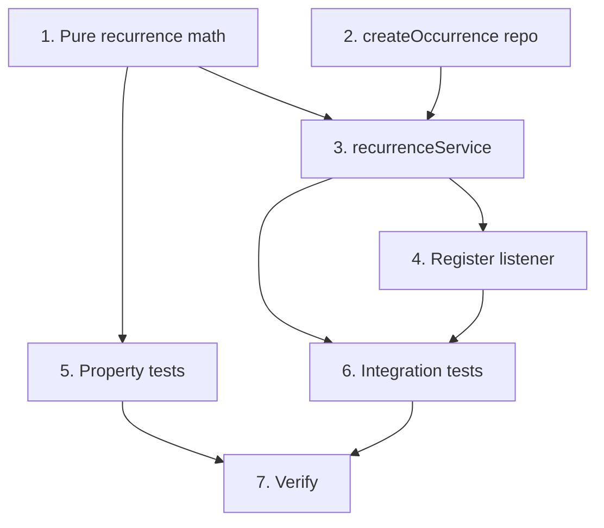

# Implementation Plan: Task Recurrence

## Overview

Order-independent completion listener that generates the next occurrence of a completed repeatable task (same `repeat_series_id`, copied fields, newly-computed `due_date`). Pure `nextDueDate` scheduling core + a new `createOccurrence` repository function that preserves the series id. NO new migration. Tasks marked `*` are optional.

## Tasks

- [ ] 1. Pure recurrence math (`src/services/tasks/recurrence.ts`)
  - `addDays(date, n)` (DST-safe UTC-noon: `Date.UTC(y,m-1,d,12) + n*86400000`, read back UTC y/m/d) and `weekdayOf(date)` (`getUTCDay()` at UTC-noon)
  - `nextDueDate(pattern, anchor): string | null`: daily = `addDays(anchor, max(1, interval ?? 1))`; weekly + non-empty `days_of_week` = earliest date strictly after anchor (scan up to 7 days) whose weekday is listed; weekly + empty/unset = `addDays(anchor, 7 * max(1, interval ?? 1))`; end_date guard returns null when next `> end_date` (YYYY-MM-DD string compare); ignore out-of-range weekday numbers, fall back to interval rule if none valid
  - Pure: no clock, DB, or timezone reads
  - _Requirements: 3.1, 3.4, 4.1, 4.2, 4.3, 4.4, 5.1, 5.4_

- [ ] 2. taskRepository.createOccurrence (`src/repositories/taskRepository.ts`)
  - Add `NewOccurrence` interface (userId, subject, priority, dueDate, dueTime|null, repeatPattern, repeatSeriesId, projectIds[]) and `createOccurrence(occ): Promise<TaskRow>`
  - Mirror `create` in one `withTransaction`: INSERT with `repeat_series_id` from the param (NOT `gen_random_uuid()`), `is_repeatable = true`, `completed_at`/`archived_at`/`weight_at_completion` left at defaults (null); reuse the private `insertAssociations(client, taskId, projectIds)` helper for project links; all parameterized
  - _Requirements: 1.4, 2.1, 2.2, 2.3, 2.4, 2.5_

- [ ] 3. recurrenceService (`src/services/tasks/recurrenceService.ts`)
  - `onTaskCompleted(event)` listener: return early if `!task.is_repeatable` OR `task.repeat_pattern == null`
  - Anchor: `task.due_date` when non-null; else resolve `tz = resolveTimezone((await userRepo.findById(event.userId))?.settings.timezone)` and use `localCalendarDate(tz)` (skip the DB lookup when due_date present)
  - `const nextDue = nextDueDate(task.repeat_pattern, anchor)`; if null, return (schedule ended); else call `taskRepo.createOccurrence({ ...copied fields, dueDate: nextDue, repeatSeriesId: task.repeat_series_id, projectIds: task.projects.map(p => p.id) })`
  - Non-throwing for expected states (non-repeatable, null pattern, missing user, ended schedule)
  - _Requirements: 1.1, 1.2, 1.3, 3.2, 3.3, 5.1, 6.1, 6.3, 7.3, 8.1, 8.2_

- [ ] 4. Register the listener
  - Add `registerCompletionListener(recurrenceService.onTaskCompleted)` in `registerAllListeners` (after the existing three; order-independent)
  - _Requirements: 7.1, 7.4_

- [ ] 5. Property-based tests (fast-check, min 100 runs each, tagged `// Feature: task-recurrence, Property N: ...`)
  - Against pure `nextDueDate` (`src/services/tasks/recurrence.property.test.ts`)
  - P1 Daily advancement: result === `addDays(anchor, max(1, interval))` (no end_date)
  - P2 Weekly weekday: result strictly after anchor, weekday listed, and earliest such date
  - P3 Weekly interval fallback: result === `addDays(anchor, 7 * max(1, interval))` (no end_date)
  - P4 End-date boundary: null iff computed next `> end_date`; null end_date never yields null
  - _Requirements: 3.1, 3.4, 4.1, 4.2, 4.3, 4.4, 5.1, 5.2, 5.3, 5.4_

- [ ] 6. Integration tests (Jest + Supertest; listener-reset determinism = recurrence listener only)
  - `src/routes/recurrence.test.ts` (or `services/tasks/recurrenceService.test.ts` via createApp): reset listeners to the recurrence listener only
  - Daily occurrence: complete a daily repeatable task with a due_date; assert one new active task, same repeat_series_id/subject/priority/due_time/pattern/projects, `due_date = anchor + interval`; original stays completed/unchanged (Req 1, 2, 3, 6.3)
  - Weekly occurrence: `days_of_week` case → next scheduled weekday; empty `days_of_week` case → interval fallback (Req 4)
  - Anchor fallback: null due_date + non-UTC user timezone → `due_date = localCalendarDate(tz) + interval` (Req 3.3, 8.1)
  - End date: next `> end_date` → no new occurrence; next `== end_date` → inserts one (Req 5)
  - Non-repeatable / null pattern → no new occurrence (Req 1.2, 1.3)
  - Series continues: complete the generated occurrence → following occurrence from it, same series (Req 6.2)
  - Single insert: one completion → exactly one new active row in the series (Req 6.1)
  - Dispatcher isolation: force listener to throw → completion still 200, error logged (Req 7.2)
  - Confirm task create body shape (isRepeatable/repeatPattern) and complete/defer endpoints from taskRoutes before use
  - _Requirements: 1.1, 1.2, 1.3, 2.1, 2.2, 2.3, 2.4, 3.1, 3.3, 4.1, 4.2, 5.1, 5.2, 6.1, 6.2, 6.3, 7.2, 8.1_

- [ ] 7. Verify — `npm run typecheck` + full `npm test` green (no regressions to the existing 141)
  - _Requirements: 7.3_

## Task Dependency Graph



```json
{
  "waves": [
    { "id": 0, "tasks": ["1", "2"] },
    { "id": 1, "tasks": ["3", "5"] },
    { "id": 2, "tasks": ["4"] },
    { "id": 3, "tasks": ["6"] },
    { "id": 4, "tasks": ["7"] }
  ]
}
```

## Notes

- **No new migration.** The Next_Occurrence is an ordinary `tasks` row; recurrence reuses `is_repeatable`/`repeat_pattern`/`repeat_series_id` and `task_projects`.
- **New repo function, not overloaded `create`:** `create` mints a fresh `repeat_series_id`; `createOccurrence` must PRESERVE the completed task series id. Keep them separate.
- **Order-independent listener:** recurrence reads only `event.task` + the user timezone (never `event.streaks`/`event.unlocked`), so registration order does not matter; the dispatcher isolates any throw so completion never fails.
- **Confirmed decisions:** DD-1 schedule-anchored (anchor = completed occurrence due_date, else user local completion day); DD-2 weekly w/o days_of_week advances 7*interval days; DD-3 due_time carries over unchanged.
- **Timezone/date discipline:** all scheduling is calendar-day math on YYYY-MM-DD via DST-safe UTC-noon; the completion-day fallback uses `localCalendarDate(resolveTimezone(user.settings.timezone))`; end_date is a YYYY-MM-DD string compare.
