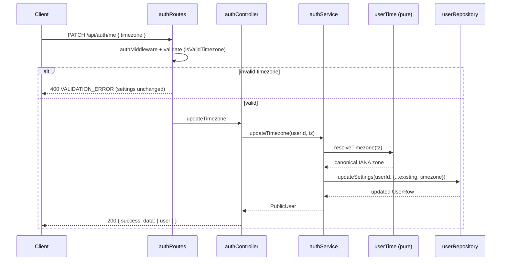
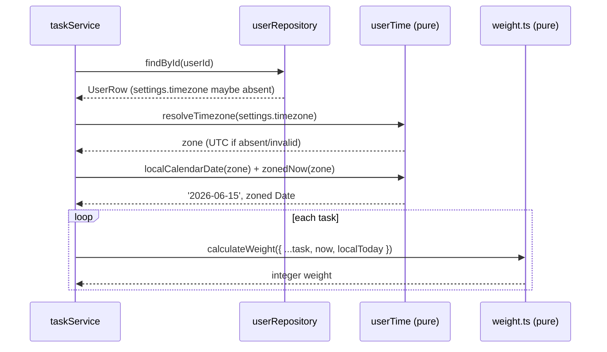

# Design Document

## Overview

This feature adds per-user timezone handling to the TaskMaster backend as a standalone abstraction. It defines how the server receives, validates, stores, and returns a user's IANA timezone, introduces a small pure `Timezone_Service` utility that yields a user's local calendar date and zoned "now" from the built-in `Intl` API, and retrofits the existing weight algorithm and deferral logic so that "now" and "today" are computed in the user's timezone rather than the server's local timezone.

The design honors three hard constraints from the requirements:

- **No database migration.** `users.settings` is already `JSONB`. The timezone is stored as a `timezone` key inside that existing document. Existing rows without the key are handled by coalescing to `UTC` at read time — there is no backfill.
- **No new runtime npm dependency.** All timezone math uses the built-in `Intl.DateTimeFormat` API.
- **Zero behavioral regression.** When a user has no timezone (or an invalid one), the effective zone resolves to `UTC`. Because the existing test environment runs in UTC and the weight tests construct `now`/due moments with server-local `Date`, a `UTC`-equivalent default keeps all 81 existing tests green.

The design maps to requirements as follows: storage/update contract (Req 1, 2), profile defaulting/return (Req 3), the `Timezone_Service` utility (Req 4), weight rezoning (Req 5), deferral rezoning (Req 6), and backward compatibility (Req 7). Streaks, recurrence, and analytics are explicitly out of scope.

## Architecture

The backend keeps its existing layering: `routes → controller → service → repository`, with raw parameterized `pg` SQL in repositories. This feature slots a new **pure utility module** (`Timezone_Service`) beneath the service layer — it performs no I/O and is consumed by both `authService` (validation on write) and `taskService` (weight + deferral on read/update).

```
                       ┌─────────────────────────────────────┐
   HTTP client ──────► │ routes/authRoutes.ts                 │
                       │  PATCH /api/auth/me   (new)          │
                       │  POST  /register|login|google (+tz)  │
                       └───────────────┬─────────────────────┘
                                       │ express-validator + validate()
                       ┌───────────────▼─────────────────────┐
                       │ controllers/authController.ts        │
                       │  updateTimezone (new), me, register… │
                       └───────────────┬─────────────────────┘
                       ┌───────────────▼─────────────────────┐
                       │ services/auth/authService.ts         │
                       │  updateTimezone (new), register…     │
                       │        │                             │
                       │        ▼ uses                        │
   ┌────────────────►  │ services/time/userTime.ts  (NEW)     │ ◄── pure, no I/O
   │  also used by     │  resolveTimezone / localCalendarDate │
   │                   │  zonedNow / nextCalendarDate         │
   │                   └───────────────┬─────────────────────┘
   │                   ┌───────────────▼─────────────────────┐
   │                   │ repositories/userRepository.ts       │
   │                   │  updateSettings (new), create* (+tz) │
   │                   └──────────────────────────────────────┘
   │
   │                   ┌──────────────────────────────────────┐
   └────────────────── │ services/tasks/taskService.ts        │
                       │  loadUserWeightContext (+timezone)   │
                       │  buildWeightInput  (+ zoned fields)  │
                       │  deferTask (rezoned later/tomorrow)  │
                       │        │                             │
                       │        ▼ passes zoned data into      │
                       │ services/tasks/weight.ts (pure)      │
                       └──────────────────────────────────────┘
```

### Component responsibilities

- **`services/time/userTime.ts` (NEW, pure):** The single source of truth for turning a stored (possibly missing/invalid) timezone string plus an instant into a validated zone, a local calendar date string, a zoned "now", and the next calendar date. Injectable clock (`now?: Date`) for deterministic tests.
- **`authService` / `userRepository`:** On write paths, validate the incoming timezone via `resolveTimezone` (explicit update rejects invalid; register/login/google silently fall back to UTC), then merge it into the settings JSONB preserving all other keys.
- **`taskService`:** On read/update paths, resolve the user's effective timezone once, pass a zoned "now" and the local calendar date into the weight input, and use them for `later_today`/`tomorrow` deferral.
- **`weight.ts` (pure):** Consumes the zoned data instead of constructing server-local dates for the calendar-day comparisons, while keeping due-proximity/age math on absolute instants.

### Update sequence (PATCH /api/auth/me)



### Weight read sequence (per request)



## Components and Interfaces

### 1. Timezone_Service — `src/services/time/userTime.ts` (NEW)

A pure module with an injectable clock. No I/O, no dependency beyond built-in `Intl`.

```ts
/** Default timezone applied whenever a stored value is missing or invalid. */
export const DEFAULT_TIMEZONE = 'UTC';

/**
 * Returns `tz` unchanged when it is a valid IANA identifier accepted by
 * Intl.DateTimeFormat; otherwise returns 'UTC'. Validation: non-empty string,
 * length <= 64, and constructing Intl.DateTimeFormat(undefined, { timeZone: tz })
 * does not throw.
 */
export function resolveTimezone(tz: unknown): string;

/**
 * Predicate form used by the express-validator custom validator on the
 * explicit-update path. True iff `tz` is a non-empty string, <= 64 chars, and
 * accepted by Intl.DateTimeFormat.
 */
export function isValidTimezone(tz: unknown): boolean;

/**
 * The user's Local_Calendar_Date as 'YYYY-MM-DD' in `tz`, relative to `now`
 * (defaults to the current system instant). Invalid `tz` falls back to UTC.
 * Implemented with Intl.DateTimeFormat('en-CA', { timeZone, year, month, day })
 * / formatToParts so the parts are the wall-clock date in that zone.
 */
export function localCalendarDate(tz: string, now?: Date): string;

/**
 * The user's Zoned_Now: the same instant `now`, but the wall-clock components
 * (y/m/d/h/m/s) reflect `tz`. Returned as a Date whose local getters yield the
 * zoned wall-clock values, suitable for the calendar-day comparisons in weight.
 * Invalid `tz` falls back to UTC.
 */
export function zonedNow(tz: string, now?: Date): Date;

/**
 * 'YYYY-MM-DD' + exactly one calendar day, computed by UTC-noon math on the
 * parsed y/m/d (DST-safe: noon avoids any transition edge and no zone is applied).
 */
export function nextCalendarDate(dateStr: string): string;
```

**Intl approach.** `Intl.DateTimeFormat('en-CA', { timeZone, year:'numeric', month:'2-digit', day:'2-digit' })` renders a date in near-ISO ordering (`YYYY-MM-DD`) for the target zone. `formatToParts` is used to read the individual `year`/`month`/`day` (and, for `zonedNow`, `hour`/`minute`/`second`) components without string-locale fragility. Because `Intl` applies the IANA rules in force at the given instant, a daylight-saving transition resolves to exactly one calendar date and one wall-clock time (Req 4.8).

**DST-safe `nextCalendarDate`.** Parse `YYYY-MM-DD`, build `Date.UTC(y, m-1, d, 12)`, add `MS_PER_DAY`, and re-read the UTC y/m/d. Using UTC noon means the +24h step can never land on the "missing" or "repeated" hour of a local DST transition, so it always advances exactly one calendar day.

### 2. Auth routes — `src/routes/authRoutes.ts`

Add one new protected route and extend three validators. Uses the existing `body(...)` + `validate([...])` + `authMiddleware` conventions.

- **`PATCH /api/auth/me`** — `authMiddleware`, then `validate([ body('timezone').custom(isValidTimezone).withMessage('Invalid timezone') ])`, then `authController.updateTimezone`.
- **`/register`, `/login`, `/google`** — add `body('timezone').optional().isString()` (no `.custom` rejection here). The service silently coalesces invalid/absent values to UTC, so validation must not 400 on these paths (Req 2.3).

### 3. authController — `src/controllers/authController.ts`

- **`updateTimezone(req, res, next)`** (new): reads `req.body.timezone`, calls `authService.updateTimezone(req.userId, timezone)`, returns `{ success: true, data: { user } }` — the same envelope as `me`.
- **`register` / `login` / `google`** (extended): read `timezone` from `req.body` and pass it through to the corresponding `authService` call.

### 4. authService — `src/services/auth/authService.ts`

- **`updateTimezone(userId, tz)`** (new): loads the user, computes `resolveTimezone(tz)` (defensive; the route already validated), merges `{ ...user.settings, timezone }`, calls `userRepo.updateSettings`, returns `toPublicUser(updated)`.
- **`register` / `login` / `loginWithGoogle`** (extended): accept an optional `timezone` param, resolve it with `resolveTimezone` (invalid → `'UTC'`), and pass the resolved value into `createPasswordUser` / `createOAuthUser`.
- **`getProfile`** relies on `toPublicUser`; the returned timezone comes from the stored settings, coalesced to UTC at read time (see Data Models).

### 5. userRepository — `src/repositories/userRepository.ts`

- **`updateSettings(userId, settings: UserSettings): Promise<UserRow>`** (new): parameterized `UPDATE users SET settings = $2, updated_at = now() WHERE id = $1 RETURNING *`, writing `JSON.stringify(settings)`.
- **`createPasswordUser` / `createOAuthUser`** (extended): accept an optional resolved `timezone` and insert `JSON.stringify({ ...DEFAULT_USER_SETTINGS, timezone: timezone ?? DEFAULT_TIMEZONE })` instead of the bare default.

### 6. taskService — `src/services/tasks/taskService.ts`

- **`UserWeightContext`** gains `timezone: string` and a resolved `localToday: string` + `now: Date` (zoned). `loadUserWeightContext` resolves `resolveTimezone(user?.settings.timezone)` once and computes `localCalendarDate(tz)` and `zonedNow(tz)` from a single instant so the whole computation shares one "now" (Req 5.1).
- **`buildWeightInput`** passes `now` (zoned) and `localToday` into the `WeightInput`.
- **`deferTask`** computes the local date from the user's zone (see below).

## Data Models

### UserSettings (extended) — `src/types/index.ts`

```ts
export interface UserSettings {
  project_priority_enabled: boolean;
  achievement_toasts_enabled: boolean;
  focus_mode_enabled: boolean;
  weight_visibility_enabled: boolean;
  theme: 'system' | 'light' | 'dark';
  timezone: string; // IANA identifier; 'UTC' by default
}

export const DEFAULT_USER_SETTINGS: UserSettings = {
  project_priority_enabled: true,
  achievement_toasts_enabled: true,
  focus_mode_enabled: false,
  weight_visibility_enabled: false,
  theme: 'system',
  timezone: 'UTC',
};
```

**Read-time coalescing (no backfill).** `PublicUser.settings` is `UserSettings` and `toPublicUser` copies `row.settings` through. For existing rows whose stored JSONB predates this feature (no `timezone` key), `toPublicUser` normalizes the timezone so the profile always reports a valid value:

```ts
export function toPublicUser(row: UserRow): PublicUser {
  return {
    ...,
    settings: { ...row.settings, timezone: resolveTimezone(row.settings.timezone) },
  };
}
```

This satisfies Req 3.1/3.3/3.4: a stored valid value is reported unchanged; a missing/empty/invalid value is reported as `UTC`. `taskService` independently applies `resolveTimezone` when loading weight context, so weight/defer never depend on a backfill either (Req 7.3).

### WeightInput (extended) — `src/services/tasks/weight.ts`

```ts
export interface WeightInput {
  createdAt: Date;
  priority: Priority;
  dueDate: string | null;   // 'YYYY-MM-DD'
  dueTime: string | null;   // 'HH:MM'
  isRepeatable: boolean;
  deferralCount: number;
  projectPriorityOrder: number | null;
  totalProjects: number;
  projectWeightingEnabled: boolean;
  /** injectable zoned "now"; defaults to new Date(). */
  now?: Date;
  /**
   * The user's Local_Calendar_Date ('YYYY-MM-DD') for the same instant as `now`.
   * When omitted, defaults to the server-local calendar day of `now` — which,
   * in the UTC test/CI environment, equals the pre-change behavior.
   */
  localToday?: string;
}
```

### UserWeightContext (extended) — `src/services/tasks/taskService.ts`

```ts
interface UserWeightContext {
  projectWeightingEnabled: boolean;
  totalProjects: number;
  orderById: Map<string, number>;
  isPremium: boolean;
  weightVisibility: boolean;
  timezone: string;   // resolved IANA zone (UTC if unset/invalid)
  now: Date;          // zonedNow(timezone) — one instant for the whole request
  localToday: string; // localCalendarDate(timezone) for that instant
}
```

## API Contract

### PATCH /api/auth/me (new)

- **Auth:** required (`authMiddleware`). Unauthenticated → 401, no `settings` returned (Req 3.5).
- **Request body:** `{ "timezone": "Asia/Tokyo" }`
- **Valid (Req 1.2, 2.1):** 200
  ```json
  { "success": true, "data": { "user": { "id": "...", "settings": { "theme": "system", "timezone": "Asia/Tokyo", "...": "..." } } } }
  ```
- **Invalid (Req 1.3, 2.2):** 400, stored settings unchanged
  ```json
  { "success": false, "error": { "code": "VALIDATION_ERROR", "message": "Invalid input data", "details": [ { "msg": "Invalid timezone", "path": "timezone" } ] } }
  ```
- **Other settings keys preserved (Req 1.4):** the merge only overwrites `timezone`.

### Timezone at registration / login / google (Req 1.5, 2.3)

Each of `POST /api/auth/register`, `/login`, `/google` accepts an **optional** `timezone` field. A valid value is stored; an absent/invalid value is ignored and `UTC` is stored (Req 1.6). These endpoints never 400 on the timezone field. Response envelope is unchanged.

## Weight Algorithm Changes (the rezoning problem)

### The problem

`weight.ts` today mixes two kinds of time math:

1. **Absolute-instant math** — age (`now.getTime() - createdAt.getTime()`) and due proximity (`dueMoment.getTime() - now.getTime()` in hours). These are correct as long as `now` and `dueMoment` are the *same instant* for both operands. They do not care about which zone `now` is expressed in.
2. **Calendar-day / wall-clock math** — `isSameLocalDay(dueMoment, now)` (used for repeatable-due-today) and `dueMomentOf` constructing `new Date(y, m-1, d, ...)` in **server-local** time. These *do* depend on the server zone.

Simply injecting a differently-zoned `now` instant does **not** fix (2): `isSameLocalDay` still reads server-local `getFullYear/getMonth/getDate`, and `dueMomentOf` still builds the wall-clock due moment in server-local time. To rezone correctly we must change the calendar-day comparison itself, not just the instant.

### Chosen approach

Pass **both** a zoned `now` **and** the user's `localToday` ('YYYY-MM-DD') into `WeightInput`, and change the two calendar-sensitive pieces to compare **date strings in the user's zone** rather than reconstructing local wall-clock dates:

- **Repeatable-due-today (Req 5.3):** replace `isSameLocalDay(dueMoment, now)` with a **string comparison** `input.dueDate === (input.localToday ?? serverLocalDay(now))`. The task's `dueDate` is already a `YYYY-MM-DD` string in the user's calendar sense, and `localToday` is the user's local calendar date for the same instant. Comparing the two strings is a pure calendar-day comparison in the user's zone — no re-derivation of wall-clock needed.
- **Due proximity / overdue (Req 5.2):** keep measuring hours between actual instants. The due moment is computed for the user's zone by combining the user's `dueDate`/`dueTime` wall-clock with the zoned `now`'s offset. In practice, because `now` is the zoned "now" and `dueMomentOf` builds the due moment with the same local getters, the *difference* between the two remains the correct signed hours-until-due. We keep `dueMomentOf` building on the wall-clock components of `dueDate`/`dueTime`, evaluated consistently with the zoned `now`.
- **Age (Req 5.4):** unchanged in form — `now.getTime() - createdAt.getTime()`. Both are absolute instants; expressing `now` in the user's zone does not change the elapsed milliseconds, only the wall-clock reading. Age is measured relative to the user's zoned "now" as required.

### Backward-compatible default

`localToday` is **optional**. When omitted, weight falls back to the server-local calendar day of `now` — exactly today's behavior. The existing `weight.test.ts` constructs `now = new Date('2026-06-15T12:00:00')` (parsed as server-local) and passes no `localToday`; in the UTC test/CI environment server-local == UTC, so:

- `input.dueDate === serverLocalDay(now)` yields the same true/false as the old `isSameLocalDay(dueMoment, now)` for those fixtures (e.g. `dueDate: '2026-06-15'` with `now` on 2026-06-15 → due today; `'2026-06-20'` → not).
- Due-proximity and age math are byte-for-byte identical because the instants are unchanged.

Therefore all repeatable/due-proximity/age assertions in `weight.test.ts` remain green with no test edits (Req 7.1, 7.6).

### Pseudocode (calculateWeightBreakdown, changed parts only)

```
now       = input.now ?? new Date()
localToday = input.localToday ?? serverLocalDay(now)   // 'YYYY-MM-DD'

// age — unchanged (absolute instants)
ageInDays = floor((now - input.createdAt) / MS_PER_DAY)
base = (ageInDays + 1) * PRIORITY_MULTIPLIER[priority]

// due proximity — unchanged hours-between-instants
dueMoment = dueMomentOf(input.dueDate, input.dueTime)
if dueMoment:
    hoursUntilDue = (dueMoment - now) / MS_PER_HOUR
    ... overdue / due-soon as before ...

// repeatable due today — NOW a calendar-day string comparison in the user's zone
if input.isRepeatable and input.dueDate and input.dueDate === localToday:
    repeatable = subtotal
    subtotal  += repeatable
```

where `serverLocalDay(d)` is the existing `toDateString` logic (local `getFullYear/getMonth/getDate`).

### taskService threading

```
ctx.timezone  = resolveTimezone(user?.settings.timezone)   // UTC if unset/invalid (Req 5.5, 7.3)
ctx.now       = zonedNow(ctx.timezone)                      // one instant for the request (Req 5.1)
ctx.localToday = localCalendarDate(ctx.timezone)            // same instant
// buildWeightInput adds: now: ctx.now, localToday: ctx.localToday
```

## Deferral Changes — `deferTask`

Replace the server-local `new Date()` + `toDateString` with the user's zone (Req 6):

```
tz         = resolveTimezone(user?.settings.timezone)   // UTC if unset/invalid (Req 6.4)
localToday = localCalendarDate(tz)                       // 'YYYY-MM-DD'

later_today   -> patch.dueDate = localToday                       // Req 6.1
tomorrow      -> patch.dueDate = nextCalendarDate(localToday)     // Req 6.2 (pure string/UTC-noon math)
sometime_later-> downgrade priority one level; clear dueDate & dueTime (unchanged, Req 6.3)
```

`deferTask` already loads the task; it will additionally load the user (or reuse `loadUserWeightContext`) to obtain the timezone. `tomorrow` uses `nextCalendarDate` on the local date string — not `Date.setDate` on a server-local `Date` — so the result is the calendar day after the user's local today, DST-safe. In the UTC test environment `localCalendarDate('UTC')` equals the server-local day, so existing defer expectations are unchanged (Req 7.2).

## Error Handling

- **Explicit update, invalid timezone (Req 1.3, 2.2):** the `PATCH /api/auth/me` validator (`body('timezone').custom(isValidTimezone)`) fails, and `validate()` throws `ApiError.badRequest('VALIDATION_ERROR', …)` → 400. No repository write occurs, so stored settings are unchanged.
- **Register/login/google, invalid or absent timezone (Req 1.6, 2.3):** no rejection. `resolveTimezone` returns `'UTC'`, which is stored; the request completes normally.
- **Missing/invalid stored value on read (Req 3.1/3.4, 7.3):** `toPublicUser` and `taskService` both coalesce via `resolveTimezone` → `'UTC'`; no error is raised.
- **Unauthenticated profile/update (Req 3.5):** `authMiddleware` returns 401 before any controller runs; no `settings` are returned.
- **DST transition (Req 4.8):** `Intl` resolves the instant to exactly one date/time per the zone's rules; `nextCalendarDate` uses UTC-noon math to avoid transition edges. No error path.
- **Invalid timezone inside `Timezone_Service` (Req 4.6/4.7):** `resolveTimezone` catches the `RangeError` thrown by `Intl.DateTimeFormat` for unknown zones and returns `'UTC'`; `localCalendarDate`/`zonedNow` resolve the zone first so they never throw on bad input.

## Correctness Properties

*A property is a characteristic or behavior that should hold true across all valid executions of a system — essentially, a formal statement about what the system should do. Properties serve as the bridge between human-readable specifications and machine-verifiable correctness guarantees.*

The pure core of this feature (`resolveTimezone`, `localCalendarDate`, `zonedNow`, `nextCalendarDate`, the settings merge, and `calculateWeight`) is well-suited to property-based testing: each is a pure function with a large input space (arbitrary timezone strings, instants, date strings, and settings documents). The following properties were derived from the prework analysis and consolidated to remove redundancy.

### Property 1: resolveTimezone is idempotent and always yields a usable zone on valid input

*For any* string that `Intl.DateTimeFormat` accepts as an IANA identifier (non-empty, ≤ 64 chars), `resolveTimezone(tz)` returns that value unchanged, `resolveTimezone(resolveTimezone(tz)) === resolveTimezone(tz)`, and the result is always a zone that `Intl.DateTimeFormat` accepts without throwing.

**Validates: Requirements 2.1, 3.3**

### Property 2: resolveTimezone falls back to UTC on any invalid input

*For any* value that is not a string, is empty, exceeds 64 characters, or is a string `Intl.DateTimeFormat` rejects (including `null` and `undefined`), `resolveTimezone(value) === 'UTC'`.

**Validates: Requirements 2.2, 3.1, 4.6, 4.7, 7.3**

### Property 3: localCalendarDate is always a valid YYYY-MM-DD for any zone and instant

*For any* timezone string and *for any* injected instant, `localCalendarDate(tz, now)` returns a string matching `^\d{4}-\d{2}-\d{2}$` that denotes a real calendar date, and the date portion of `zonedNow(tz, now)` equals that same string.

**Validates: Requirements 4.1, 4.2, 4.4**

### Property 4: an invalid timezone computes the same local date as UTC

*For any* invalid timezone value and *for any* injected instant, `localCalendarDate(invalidTz, now) === localCalendarDate('UTC', now)` and `zonedNow(invalidTz, now)` matches `zonedNow('UTC', now)`.

**Validates: Requirements 4.6, 4.7, 5.5**

### Property 5: nextCalendarDate advances exactly one calendar day

*For any* valid `YYYY-MM-DD` string (including month ends, year ends, Feb 29 on leap years, and dates falling on daylight-saving transition days), `nextCalendarDate(dateStr)` returns the unique calendar date one day later, and applying it 365 or 366 times advances exactly one year.

**Validates: Requirements 4.8, 6.2**

### Property 6: updating the timezone preserves all other settings

*For any* existing `UserSettings` document and *for any* valid timezone value, merging the new timezone leaves every other key and its value unchanged, and the only difference between the input and output documents is the `timezone` key.

**Validates: Requirements 1.4**

### Property 7: UTC (or unset) timezone reproduces the pre-change baseline weight

*For any* `WeightInput`, the weight computed with the timezone unset (`localToday` omitted, evaluated in the UTC environment) equals the weight computed with `localToday = localCalendarDate('UTC', now)`, which in turn equals the weight produced by the pre-change server-local algorithm in a UTC environment.

**Validates: Requirements 5.5, 7.1**

### Property 8: repeatable-due-today follows the user's local calendar day

*For any* repeatable task with a due date and *for any* timezone and instant, the repeatable doubling contribution is applied if and only if the task's `dueDate` equals `localCalendarDate(tz, now)`. Consequently, at a boundary instant where two zones disagree on the calendar day (e.g. `Asia/Tokyo` vs `UTC`), the same task is "due today" in one zone and not the other.

**Validates: Requirements 5.3**

## Testing Strategy

### Approach

- **Property-based tests** cover the pure functions above (Properties 1–8). A property-based testing library for TypeScript/Jest — **`fast-check`** (added as a `devDependency` only; runtime `dependencies` stay unchanged per Req 7.5) — is used. We do not implement property testing from scratch. Each property test runs **≥ 100 iterations** (fast-check default `numRuns` set to at least 100) and is tagged with a comment referencing its design property.
- **Unit / example tests** cover concrete scenarios, edge cases, and error conditions.
- **Integration tests** (Supertest, following `authRoutes.test.ts`) cover the HTTP contract.
- **Smoke checks** cover the structural guarantees (migration count, dependency list, whole-suite pass).

Tag format for each property test: `// Feature: user-timezone, Property {n}: {property text}`.

### Property tests (fast-check, ≥ 100 iterations each)

- **`userTime.test.ts`** — Properties 1–5:
  - P1: arbitrary picks from a curated list of valid IANA zones → `resolveTimezone` returns unchanged and result is Intl-acceptable; idempotence.
  - P2: `fc.anything()` filtered to invalid inputs (plus `null`, `''`, 65-char strings, `'Not/AZone'`) → `resolveTimezone` returns `'UTC'`.
  - P3: `fc.date()` × arbitrary zone → `localCalendarDate` matches the date regex and is a real date; `zonedNow` date part equals it.
  - P4: invalid zone × `fc.date()` → `localCalendarDate` equals the UTC result.
  - P5: `fc.date()`-derived date strings (and hand-picked leap/DST edge dates) → `nextCalendarDate` advances exactly one day; N-day chains advance N days.
- **`weight.test.ts` (additions)** — Properties 7 & 8, added alongside the existing suite:
  - P7: arbitrary `WeightInput` → weight with `localToday` omitted equals weight with `localToday = localCalendarDate('UTC', now)`.
  - P8: arbitrary repeatable task + zone/instant → doubling applied iff `dueDate === localCalendarDate(tz, now)`.
- **`settingsMerge` (in `userTime.test.ts` or `authService.test.ts`)** — Property 6: arbitrary `UserSettings` × valid zone → only `timezone` changes.

### Example / edge-case unit tests

- **DST divergence:** at an instant that is one calendar day in `Asia/Tokyo` but the previous day in `UTC`, `localCalendarDate` returns the two expected distinct dates; a repeatable task due on the Tokyo date is "due today" for Tokyo and not for UTC (concrete companion to Property 8).
- **Injected clock (Req 4.4/4.5):** fixed injected `Date` yields a deterministic date; omitting the clock yields today's date.
- **`nextCalendarDate` edges:** `'2024-02-28' → '2024-02-29' → '2024-03-01'`; `'2023-12-31' → '2024-01-01'`; a spring-forward DST day → next day.
- **resolveTimezone fallback edges:** `undefined`, `null`, `''`, `'   '`, 65-char string, `'Mars/Phobos'` all → `'UTC'`.

### Weight & deferral service tests

- **Weight (Req 5):** Tokyo vs UTC "due today" divergence for a repeatable task at a boundary instant produces different weights (Tokyo doubles, UTC does not). Age and due-proximity for a fixed instant are unaffected by the zone label.
- **Defer (Req 6):** with a non-UTC zone, `later_today` sets `dueDate = localCalendarDate(zone)`, `tomorrow` sets `nextCalendarDate(localCalendarDate(zone))`, `sometime_later` downgrades priority and clears due (zone-independent). With unset/invalid zone, outcomes equal the UTC outcomes (Req 6.4, 7.2).

### Endpoint tests (Supertest, follows `authRoutes.test.ts`)

- `PATCH /api/auth/me` with a valid zone → 200, body `settings.timezone` updated, other settings keys preserved (Req 1.2, 1.4).
- `PATCH /api/auth/me` with an invalid zone → 400 `VALIDATION_ERROR`; a subsequent `GET /me` shows the prior value unchanged (Req 1.3, 2.2).
- `PATCH /api/auth/me` without auth → 401, no `settings` (Req 3.5).
- `POST /register` with a valid zone → stored; without a zone → `'UTC'` (Req 1.5, 1.6); with garbage → 201 and `'UTC'` (Req 2.3).
- `GET /me` for a user whose stored settings lack `timezone` → reports `'UTC'` (Req 3.4).

### Backward-compatibility / smoke checks (Req 7)

- **All 81 existing tests across 12 suites pass with 0 failures (Req 7.6):** the design keeps `now`/`dueMoment` instant math identical and makes `localToday` optional with a server-local (== UTC in CI) default, so no existing `weight.test.ts` or route-test assertion changes. The suite is run to confirm.
- **Migration count unchanged (Req 7.4):** assert exactly the 4 existing migration files; no new file is added.
- **Runtime dependencies unchanged (Req 7.5):** `fast-check` is a `devDependency`; the `dependencies` block of `package.json` is unchanged; the feature uses only built-in `Intl`.
